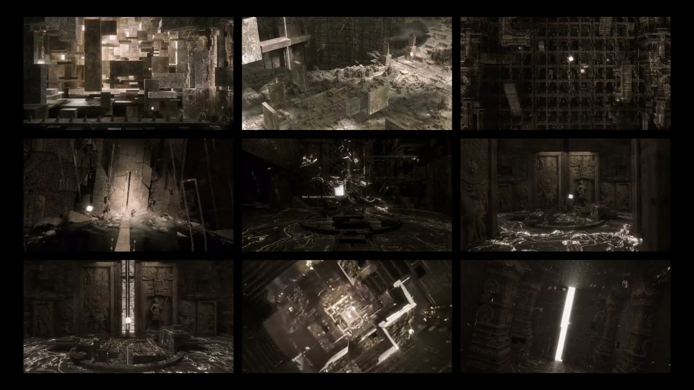

# Creative Workflows / Muwen Li

**I build from hands-on visual production: I know where complex creative work gets stuck, and use AI and code to turn those bottlenecks into usable tools.**

My focus is the connection between production craft and product decisions: automate repeatable work, keep creative choices editable, and make the result inspectable before delivery.

**7 projects · A commercial asset library, interactive tools and a company production case**

**Start here:** [Production → product: Clockwork](https://github.com/MuwenTriLi/steampunk-clockwork-showcase/blob/main/docs/production-case.md) · [Feedback → iteration: Collage Motion](projects/03-collage-motion.md#from-production-experience-to-product-decisions) · [Try Model Breakdown](https://meshroom-breakdown-studio.limuwen9.chatgpt.site)

[Evidence & next experiments](docs/review-guide.md) · [Functional checks & known limits](docs/functional-review.md) · [Automation & creator control](docs/creative-control.md)

## Selected work

**Project** opens the project overview and process. **Open** takes you directly to the product or interactive app. Each case explains the design problem, the workflow and the evidence available to review.

| Project | Problem → approach | Format | Open |
| --- | --- | --- | --- |
| **01 · [Steampunk Clockwork](https://github.com/MuwenTriLi/steampunk-clockwork-showcase)** | Repeated mechanical setup → reusable assemblies & editable motion | Blender assets + Skill | [Superhive product ↗](https://superhivemarket.com/products/steampunk-clockwork-animated-assets) |
| **02 · [Model Breakdown Studio](https://github.com/MuwenTriLi/model-breakdown-studio)** | Hard-to-read 3D assemblies → explode, isolate & explain | MIT code + browser tool | [Open web app ↗](https://meshroom-breakdown-studio.limuwen9.chatgpt.site) |
| **03 · [Blue / White Architecture Growth](projects/blue-white-architecture-growth.md)** | Company aesthetics → reusable styling & staged construction | Company workflow case | [Watch selected films](docs/architecture-growth-media.md#watch-the-selected-films) |
| **04 · [Collage Motion](projects/03-collage-motion.md)** | Scattered shot previews → an editable moving storyboard | Browser tool | [Open web app ↗](https://muwentrili.github.io/creative-workflows/collage-motion/) |
| **05 · [FLIPFRAME](projects/04-flipframe.md)** | Media sequencing & pacing → editable spatial presentation | Browser tool | [Open web app ↗](https://flipframe-motion-lab.limuwen9.chatgpt.site) |
| **06 · [VOX / ONE](projects/05-vox-one.md)** | Speech/type synchronization → editable timed typography | Browser tool | [Open web app ↗](https://vox-one.limuwen9.chatgpt.site) |
| **07 · [TRACE / 01](projects/06-trace-01.md)** | Moving subjects need context → tracking & readable overlays | Browser tool | [Open web app ↗](https://trace-01-motion-tracker.limuwen9.chatgpt.site) |

**Current review:** short hosted exports were checked for Model Breakdown and VOX; Collage has short export checks. FLIPFRAME and TRACE have known export-timing issues in the tested browser. [Read the exact scope](docs/functional-review.md).

**Try first:** Model Breakdown Studio opens with Wood House and offers three supplied GLB examples, plus local import. Collage Motion opens with nine moving sample shots, a 40-clip library and a visible import action for your own media. All five browser tools have public entrances; VOX / ONE and TRACE / 01 also need your own input media. Architecture Growth presents completed illoca work and its production method; company source and Skill files are not distributed.

## 01 / Clockwork — detail preview

**46 animated assets · Linked mechanisms · Editable controls**

<table>
<tr>
<td width="46%" align="center" valign="top"> <b>Collection overview</b> Original render · clocks and mechanical assemblies</td>
<td width="27%" align="center" valign="top"> <b>Motion study</b> Animated turntable · exposed movement</td>
<td width="27%" align="center" valign="top"> <b>Controlled opening</b> Linked mechanism · adjustable speed and phase</td>
</tr>
</table>

My design direction and model collection became a reusable Blender library, with Codex-assisted development. The documented workflow connects component inspection, control adjustments and modular reuse.

[Full case study](https://github.com/MuwenTriLi/steampunk-clockwork-showcase) · [Control reference](https://github.com/MuwenTriLi/steampunk-clockwork-showcase/blob/main/docs/controls.md) · [Workflow + Skill](https://github.com/MuwenTriLi/steampunk-clockwork-showcase/blob/main/docs/workflow-skill.md)

## 02 / Model Breakdown Studio — interactive preview

<table>
<tr>
<td width="48%" valign="top"></td>
<td width="52%" valign="top"><b>Turn a 3D model into an explanation.</b>  Inspect components, compose an exploded view, highlight parts and arrange motion.  <b><a href="https://meshroom-breakdown-studio.limuwen9.chatgpt.site">Open the interactive app →</a></b> No sign-in required. Choose Wood House or either production line, or import your own GLB.  <a href="https://github.com/MuwenTriLi/model-breakdown-studio">Read the case study</a> · <a href="https://github.com/MuwenTriLi/model-breakdown-studio#try-it-in-one-minute">One-minute walkthrough</a></td>
</tr>
</table>

<table><tr>
<td width="50%" align="center"> Finished AEC output / structural emphasis</td>
<td width="50%" align="center"> Component relationships / selected output</td>
</tr></table>

## 03 / Architecture Growth — company production case

<table><tr>
<td width="40%" align="center"></td>
<td width="60%" valign="top"><b>Company aesthetics → a repeatable production method.</b>  As Creative Content Director at <b>illoca</b>, I direct a shared architectural visual language and an internal Blender workflow, refined across detail, tower and tennis-venue studies.  <a href="projects/blue-white-architecture-growth.md">Read the case and control decisions</a> · <a href="docs/architecture-growth-media.md#watch-the-selected-films">Watch the selected films</a>  Company portfolio presentation. Completed visuals and high-level method only; no company Skill, source scenes or reuse license.</td>
</tr></table>

## 04–07 / Four different creative problems

| [Collage Motion](projects/03-collage-motion.md) | [FLIPFRAME](projects/04-flipframe.md) | [VOX / ONE](projects/05-vox-one.md) | [TRACE / 01](projects/06-trace-01.md) |
| --- | --- | --- | --- |
|  |  |  |  |
| Shot review & moving storyboard | Sequence & pacing | Speech & type | Tracking & annotation |

These are an exported Collage sample board and current editor views. Each project page provides the problem, design choices, a short walkthrough and verification limits. Selected final films and process recordings will be added as they are prepared; no measured efficiency or user-study results are claimed.

## How I turn production experience into a tool

Start with a specific production decision, build the smallest usable workflow around it, then inspect both the result and the creator's ability to correct it. Each case identifies **what the system handles, what the creator decides, and what must be checked before delivery**.

Clockwork is the most complete existing production-to-product case: original models and design standards became editable mechanisms and a packaged asset library. Model Breakdown is the quickest interactive example. Collage Motion adds a concrete feedback-to-implementation iteration. The remaining tools explore distinct parts of a creative pipeline, with their readiness and next tests in the [evidence review](docs/review-guide.md).

**Evidence is labeled:** existing product and working controls; documented checks; proposed agent behavior and validation work still to do. AI-assisted development is part of these projects. An autonomous agent is not claimed for every browser tool. [See the control model and engineering handoff](docs/creative-control.md).

## Where to find things

- **This repository** is the portfolio index. The [projects folder](projects/) contains the browser-tool case studies and the architecture-growth framework, with current evidence and access information where available.
- **[Model Breakdown Studio](https://github.com/MuwenTriLi/model-breakdown-studio)** links to the original interactive web app and contains the project presentation, walkthrough outline and recording folder.
- **[Clockwork case study](https://github.com/MuwenTriLi/steampunk-clockwork-showcase)** contains the renders, motion gallery, controls, design process and commercial product link.
- **[Clockwork workflow + Skill](https://github.com/MuwenTriLi/steampunk-clockwork-showcase/blob/main/docs/workflow-skill.md)** explains the reusable method. [SKILL.md](https://github.com/MuwenTriLi/steampunk-clockwork-showcase/blob/main/skills/clockwork-assembly/SKILL.md) contains the actual instructions.

Projects 01–05 are the first preparation group; 06–07 follow. Architecture Growth now includes selected completed company visuals and a high-level method; an approved process/correction recording remains to add. Numbers indicate portfolio order. Clockwork, Model Breakdown Studio and this index are public. The browser tools are interactive prototypes; their pages distinguish available controls from verified outcomes. The Clockwork instruction Skill has not yet been tested end to end on a new Blender task.
