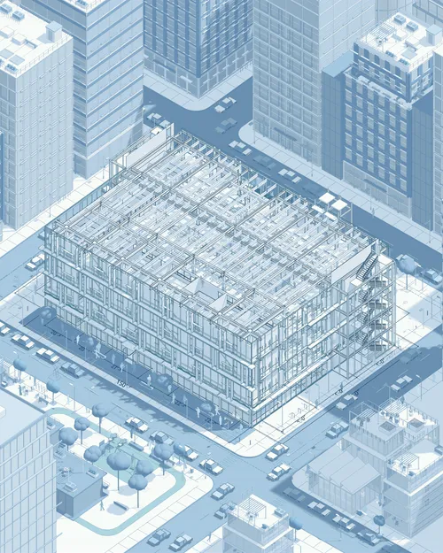
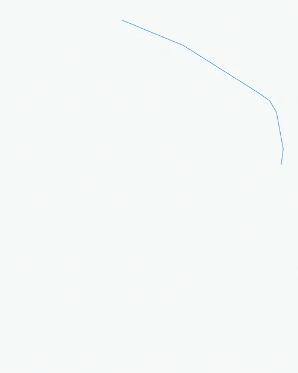
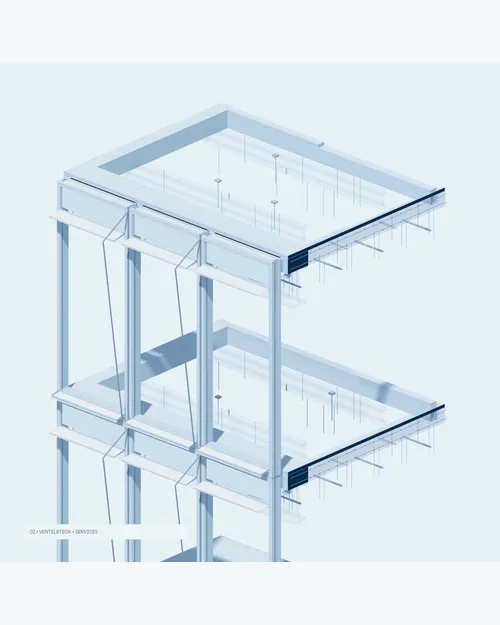
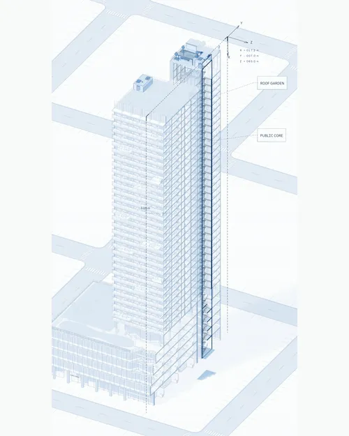
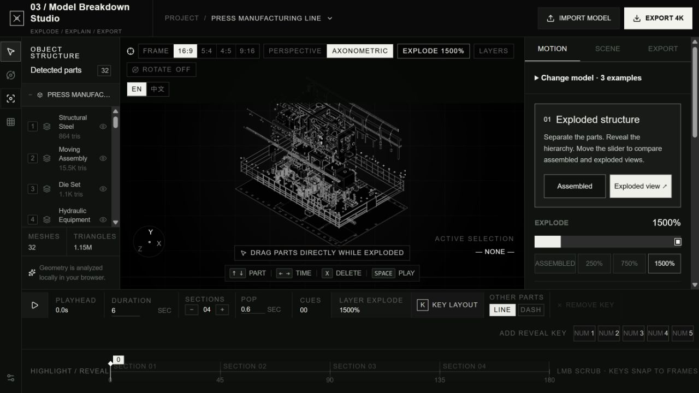
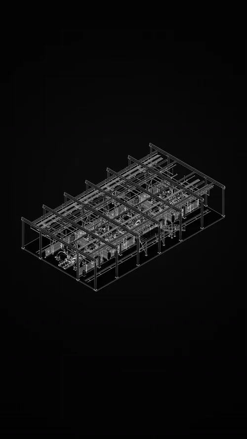
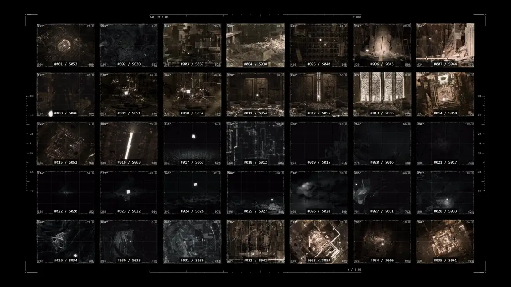
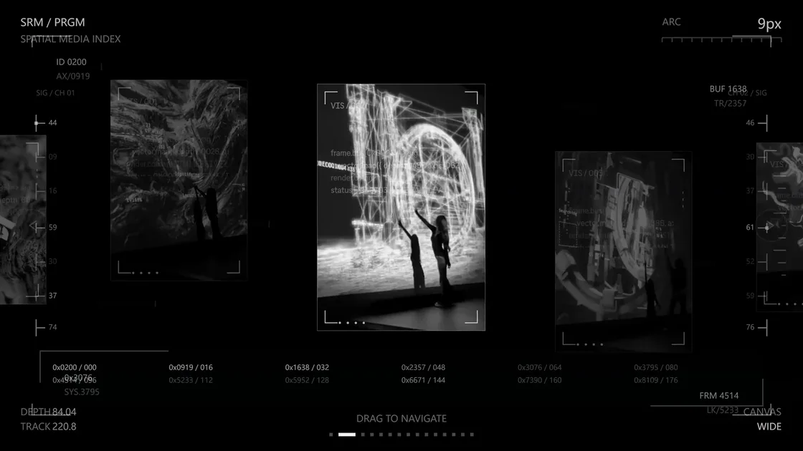
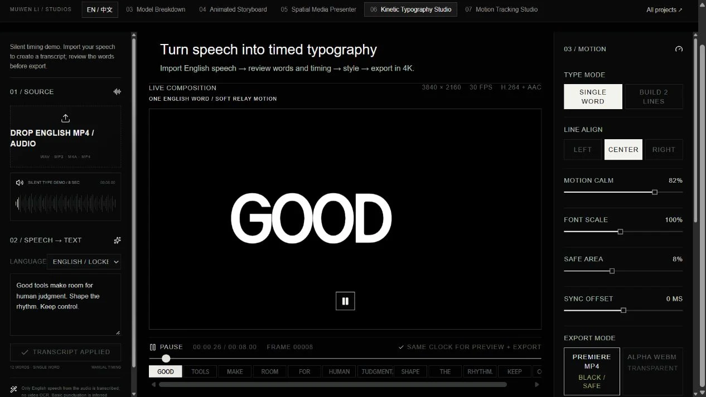
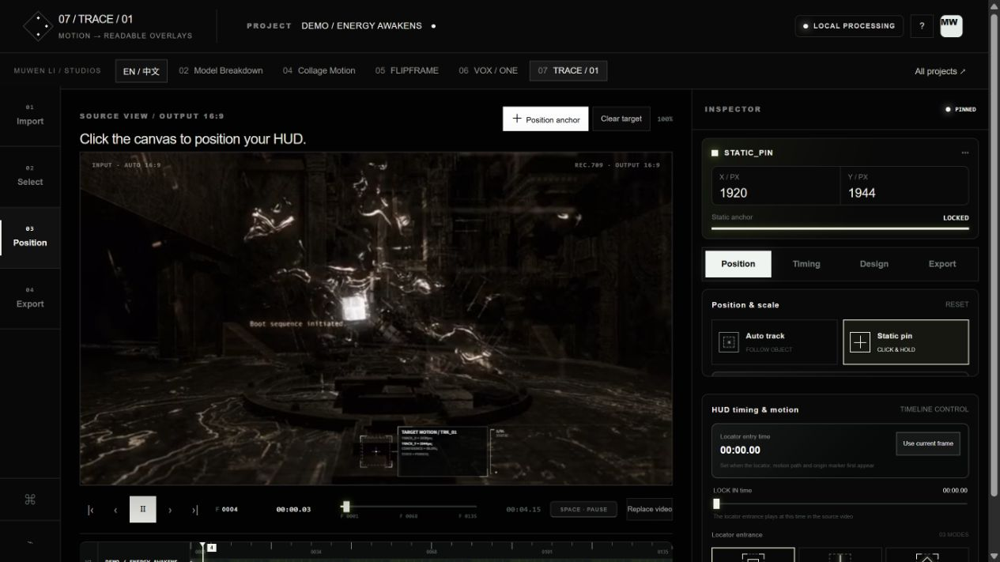

# Creative Workflows

Tools and production work for turning 3D models, footage and speech into editable visual explanations.

**Muwen Li** — creative technology and 3D production. Contributions include original modeling for Clockwork, creative content direction at illoca, and browser-tool design with Codex-assisted implementation.

**Technology:** Blender; JavaScript/TypeScript and React; Three.js, Canvas and WebCodecs; local Whisper speech recognition. The browser projects document what runs, what the creator controls and what has actually been tested.

## Selected work

Open a **project** for its visual gallery and project details; browser projects also include workflow and local setup. **Demo** opens final films or a working app; **Product page** opens the Clockwork listing on Superhive. Projects remain in the same 01–07 order.

| Project | Purpose | Preview / Product |
| --- | --- | --- |
| **01 · [Clockwork](projects/01-clockwork/)** | Original models → linked Blender mechanisms and editable controls | [Product page](https://superhivemarket.com/products/steampunk-clockwork-animated-assets) |
| **02 · [Blue / White Architecture Growth](projects/02-architecture-growth/)** | Selected final architectural films · illoca property / NDA | [Demo](https://muwentrili.github.io/creative-workflows/films/?project=growth&film=tennis-sequence) |
| **03 · [Model Breakdown Studio](projects/03-model-breakdown/)** | Multi-part GLB → exploded explanation and timed emphasis | [Demo](https://meshroom-breakdown-studio.limuwen9.chatgpt.site) |
| **04 · [Animated Storyboard](projects/04-animated-storyboard/)** | Separate clips → one editable moving review board | [Demo](https://muwentrili.github.io/creative-workflows/collage-motion/) |
| **05 · [Spatial Media Presenter](projects/05-spatial-media-presenter/)** | Images and clips → spatial sequence with readable holds | [Demo](https://flipframe-motion-lab.limuwen9.chatgpt.site) |
| **06 · [Kinetic Typography Studio](projects/06-kinetic-typography/)** | English speech → corrected words, timing and animated type | [Demo](https://vox-one.limuwen9.chatgpt.site) |
| **07 · [Motion Tracking Studio](projects/07-motion-tracking/)** | Video and selected target → motion annotation | [Demo](https://trace-01-motion-tracker.limuwen9.chatgpt.site) |

## 01 / Clockwork

<p align="center">
<a href="projects/01-clockwork/"></a>
<a href="https://muwentrili.github.io/creative-workflows/films/?project=clockwork&amp;film=opening-in-blender"></a>
</p>

<p><em>Left to right:</em> Collection in motion · Opening mechanism in Blender</p>

Original models developed into a 46-asset Blender library with linked mechanisms and editable motion controls.

[Project](projects/01-clockwork/)

## 02 / Blue / White Architecture Growth

<p align="center">
<a href="projects/02-architecture-growth/"></a>
<a href="projects/02-architecture-growth/"></a>
<a href="projects/02-architecture-growth/"></a>
<a href="projects/02-architecture-growth/"></a>
</p>

<p><em>Left to right:</em> Building &amp; context · Plan to structure · Detail &amp; assembly · Tower &amp; levels</p>

Selected final illoca films. Company property under NDA; this case provides Demo outputs and credits only.

[Demo and credits](projects/02-architecture-growth/)

## 03 / Model Breakdown Studio

<p align="center">
<a href="https://meshroom-breakdown-studio.limuwen9.chatgpt.site"></a>
<a href="https://muwentrili.github.io/creative-workflows/model-breakdown-films/#equipment"></a>
<a href="https://muwentrili.github.io/creative-workflows/model-breakdown-films/#structure"></a>
</p>

<p><em>Left to right:</em> Interactive studio · Equipment explanation · Structural hierarchy</p>

Import a multi-part GLB, separate its components and direct visual emphasis. The films are supplied output examples; the project documents the app, local setup and validation scope.

[Project](projects/03-model-breakdown/)

## 04 / Animated Storyboard

<p align="center">
<a href="https://muwentrili.github.io/creative-workflows/collage-motion/"></a>
</p>

<p><b>A moving storyboard for shot review</b> — <sub>35 supplied shots · Six white HUD styles · Editable order and framing</sub></p>

Compare 35 moving shots on one board, preview a source, revise its position or visibility, then export the accepted composition.

[Project](projects/04-animated-storyboard/)

## 05 / Spatial Media Presenter

<p align="center">
<a href="https://muwentrili.github.io/creative-workflows/collage-motion/process/flipframe-sequence.mp4"></a>
</p>

<p><b>A spatial presentation with editable pacing</b> — <sub>25-second exported sequence · Click the preview to watch in 1080p</sub></p>

Arrange images and clips into a spatial presentation with editable order, framing, transitions and holds.

[Project](projects/05-spatial-media-presenter/)

## 06 / Kinetic Typography Studio

<p align="center">
<a href="https://vox-one.limuwen9.chatgpt.site"></a>
</p>

<p><b>Editable words, timing and visual emphasis</b> — <sub>Speech-led typography · Transcript correction · Preview before delivery</sub></p>

Turn English speech into timed typography with editable words, rhythm and emphasis. The opening example is silent; speech recognition starts after import.

[Project](projects/06-kinetic-typography/)

## 07 / Motion Tracking Studio

<p align="center">
<a href="https://trace-01-motion-tracker.limuwen9.chatgpt.site"></a>
</p>

<p><b>Make a subject easier to follow</b> — <sub>Your video · Target 01 or a fixed position anchor · Editable white HUD</sub></p>

Add editable graphic overlays to a selected subject or fixed position in uploaded video. The project records current tracking and export limits.

[Project](projects/07-motion-tracking/)


## Repository structure

```text
creative-workflows/
├── README.md
├── projects/
│   ├── 01-clockwork/                Blender library: public documentation and evidence
│   ├── 02-architecture-growth/      Final company Demo and credits only (NDA)
│   ├── 03-model-breakdown/          README, source/, example models and evidence
│   ├── 04-animated-storyboard/      README and evidence; static app in docs/
│   ├── 05-spatial-media-presenter/  README, source/ and evidence
│   ├── 06-kinetic-typography/       README, source/ and evidence
│   └── 07-motion-tracking/          README, source/ and export evidence
├── docs/
│   ├── collage-motion/             Storyboard source and GitHub Pages app
│   ├── films/                      Final film viewer
│   └── model-breakdown-films/       Selected complete output films
└── media/                          Portfolio previews and final presentation media
```

Setup commands live in each app's README. Source snapshots identify their hosted revision and preserve their existing rights; public media is not a stock asset library. The company case is Demo-only. Versioned demo archives are published in [Releases](https://github.com/MuwenTriLi/creative-workflows/releases).
