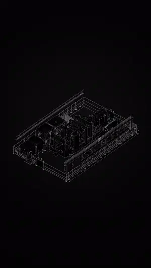
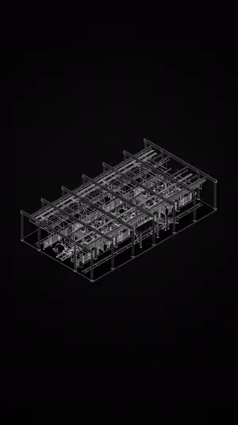

# Creative Workflows

**Tools and workflows for turning creative-production inputs into editable, reviewable outputs.**

A collection of projects for 3D explanation, shot review, media presentation and motion graphics. Each project documents its inputs, workflow, implementation, creator controls and tested outputs.

[Five-minute review](docs/interview-guide.md) · [Project directory](projects/) · [Repository map](#repository-map) · [Source & local setup](docs/distribution.md) · [Verification records](docs/functional-review.md) · [About the author](#about-the-author)

## Selected work

Start with a **project** to understand the task and how it works, or use **Open** to try the app, watch a film or visit the product. No GitHub account is needed to browse. The projects follow the same 01–07 order throughout the collection.

| Project | Input → useful output | Open |
| --- | --- | --- |
| **01 · [Clockwork](https://github.com/MuwenTriLi/steampunk-clockwork-showcase)** | Original modeled components → linked Blender mechanisms and reusable controls | [Superhive product](https://superhivemarket.com/products/steampunk-clockwork-animated-assets) |
| **02 · [Blue / White Architecture Growth](projects/02-architecture-growth/)** | Architectural scenes + visual brief → staged construction films | [Watch films](https://muwentrili.github.io/creative-workflows/films/?project=growth&film=tennis-sequence) |
| **03 · [Model Breakdown Studio](https://github.com/MuwenTriLi/model-breakdown-studio)** | Multi-part GLB → exploded explanation and timed emphasis | [Open web app](https://meshroom-breakdown-studio.limuwen9.chatgpt.site) |
| **04 · [Animated Storyboard](projects/04-animated-storyboard/)** | Separate clips → one editable moving review board | [Open web app](https://muwentrili.github.io/creative-workflows/collage-motion/) |
| **05 · [Spatial Media Presenter](projects/05-spatial-media-presenter/)** | Images and clips → a spatial sequence with readable holds | [Open web app](https://flipframe-motion-lab.limuwen9.chatgpt.site) |
| **06 · [Kinetic Typography Studio](projects/06-kinetic-typography/)** | English speech → corrected words, timing and animated type | [Open web app](https://vox-one.limuwen9.chatgpt.site) |
| **07 · [Motion Tracking Studio](projects/07-motion-tracking/)** | Video + selected target or anchor → a motion annotation | [Try prototype](https://trace-01-motion-tracker.limuwen9.chatgpt.site) |

Project pages distinguish shipped work, inspectable prototypes and remaining validation. Motion Tracking Studio now includes a documented export repair and bounded 4K checks; real-footage recovery remains a prototype limitation.

## 01 / Clockwork

<table>
<tr>
<td width="46%" align="center" valign="top"><a href="media/clockwork-collection.png"></a><br><b>Packaged outcome</b><br><sub>46 animated assets · my source models and design direction</sub></td>
<td width="27%" align="center" valign="top"><a href="https://github.com/MuwenTriLi/steampunk-clockwork-showcase#motion-is-part-of-the-design"></a><br><b>Motion study</b><br><sub>Animated turntable · exposed movement</sub></td>
<td width="27%" align="center" valign="top"><a href="https://github.com/MuwenTriLi/steampunk-clockwork-showcase/blob/main/docs/controls.md#opening-and-folding--clk32-aperture"></a><br><b>Controlled opening</b><br><sub>Linked mechanism · adjustable speed and phase</sub></td>
</tr>
</table>

Original modeling → AI-assisted linkage development → creator controls. The 46-asset Blender library is the packaged outcome; the project explains the inputs, dependencies and a [checked control change](https://github.com/MuwenTriLi/steampunk-clockwork-showcase/blob/main/docs/control-study.md).

[Project overview, workflow and evidence →](https://github.com/MuwenTriLi/steampunk-clockwork-showcase)

## 02 / Blue / White Architecture Growth

<table>
<tr>
<td width="33%" align="center" valign="top"><a href="docs/architecture-growth-media.md#watch-the-selected-films"></a></td>
<td width="33%" align="center" valign="top"><a href="projects/02-architecture-growth/"></a></td>
<td width="33%" align="center" valign="top"><a href="docs/architecture-growth-media.md#watch-the-selected-films"></a></td>
</tr>
<tr><td align="center"><b>Building & context</b></td><td align="center"><b>Plan to structure</b></td><td align="center"><b>Detail & assembly</b></td></tr>
<tr><td align="center" valign="top">A consistent blue-white visual language</td><td align="center" valign="top">Spatial reference before visual density</td><td align="center" valign="top">Readable systems and construction order</td></tr>
</table>

A repeatable visual and construction method applied across architectural scales. This company case presents approved outputs and production decisions; internal source scenes and Skills remain private.

[Project overview, workflow and evidence →](projects/02-architecture-growth/)

## 03 / Model Breakdown Studio

<table><tr>
<td width="46%" align="center" valign="top"><a href="https://meshroom-breakdown-studio.limuwen9.chatgpt.site"></a><br><b>Interactive studio</b><br><sub>Choose a GLB · explode · highlight · export</sub></td>
<td width="27%" align="center" valign="top"><a href="https://muwentrili.github.io/creative-workflows/model-breakdown-films/#equipment"></a><br><b>Explain the equipment</b><br><sub>Production line · component emphasis</sub></td>
<td width="27%" align="center" valign="top"><a href="https://muwentrili.github.io/creative-workflows/model-breakdown-films/#structure"></a><br><b>Separate the systems</b><br><sub>Structural hierarchy · complete sequence</sub></td>
</tr></table>

Inspect a GLB, separate its systems and focus attention on a component. The project includes the current browser-source snapshot, a local runner and the distinction from the earlier implementation.

[Project overview, workflow and evidence →](https://github.com/MuwenTriLi/model-breakdown-studio)

## 04 / Animated Storyboard

<table><tr>
<td align="center" valign="top"><a href="https://muwentrili.github.io/creative-workflows/collage-motion/"></a><br><b>A moving storyboard for shot review</b><br><sub>35 supplied shots · Six white HUD styles · Editable order and framing</sub></td>
</tr></table>

Compare 35 moving shots on one board, preview a source, change its position or hide it, then export the accepted composition. Source, a versioned demo and an implementation/test map are included.

[Project overview, workflow and evidence →](projects/04-animated-storyboard/)

## 05 / Spatial Media Presenter

<table><tr>
<td align="center" valign="top"><a href="https://flipframe-motion-lab.limuwen9.chatgpt.site"></a><br><b>A spatial presentation with editable pacing</b><br><sub>15 supplied visuals · Orbital Shift on entry · Control order, framing and timing</sub></td>
</tr></table>

Move from a collection overview to individual works with editable order, framing, transitions and holds. The supplied 15-work example starts in Orbital Shift.

[Project overview, workflow and evidence →](projects/05-spatial-media-presenter/)

## 06 / Kinetic Typography Studio

<table><tr>
<td align="center" valign="top"><a href="https://vox-one.limuwen9.chatgpt.site"></a><br><b>Editable words, timing and visual emphasis</b><br><sub>Speech-led typography · Transcript correction · Preview before delivery</sub></td>
</tr></table>

Connect English speech recognition, transcript correction and visual rhythm. The silent opening example demonstrates typography; importing speech exercises local Whisper inference.

[Project overview, workflow and evidence →](projects/06-kinetic-typography/)

## 07 / Motion Tracking Studio

<table><tr>
<td align="center" valign="top"><a href="https://trace-01-motion-tracker.limuwen9.chatgpt.site"></a><br><b>Make a subject easier to follow</b><br><sub>Your video · Target 01 or a fixed position anchor · Editable white HUD</sub></td>
</tr></table>

Import footage and choose the subject or a fixed anchor before adding graphics. Inspect the tracking and export implementation alongside its current delivery limitations.

[Project overview, workflow and evidence →](projects/07-motion-tracking/)

## Repository map

```text
creative-workflows/
├── README.md                         Collection overview and seven previews
├── projects/
│   ├── README.md                     Project directory, including separate repos
│   ├── 02-architecture-growth/       Company case: overview + method + credits
│   ├── 04-animated-storyboard/       Overview + workflow + source/test pointers
│   ├── 05-spatial-media-presenter/   Overview + docs + runnable source/
│   ├── 06-kinetic-typography/        Overview + docs + runnable source/
│   └── 07-motion-tracking/           Overview + docs + runnable source/
├── docs/
│   ├── collage-motion/              Canonical Storyboard source and Pages app
│   ├── films/                       Public film viewer and viewing copies
│   ├── model-breakdown-films/       Selected complete output films
│   ├── distribution.md              Local setup, releases and source versions
│   ├── functional-review.md         Bounded checks and known failures
│   └── studio-delivery.md           Per-tool export steps
└── media/                           Overview and case-study previews
```

**Separate project repositories:** [01 / Clockwork](https://github.com/MuwenTriLi/steampunk-clockwork-showcase) · [03 / Model Breakdown Studio](https://github.com/MuwenTriLi/model-breakdown-studio). Storyboard's source remains under `docs/collage-motion/` to preserve its published app URL. Earlier case filenames remain as navigation pages for shared links. Downloadable demo archives belong in [Releases](https://github.com/MuwenTriLi/creative-workflows/releases).

## About the author

**Muwen Li** — creative technology, 3D production and AI-assisted tools. I modeled the original Clockwork source collection, direct creative content at illoca, and develop browser workflows with Codex-assisted implementation. Each project separates my contribution, system behavior and the evidence available to review.

[Production decisions and next experiments](docs/review-guide.md) · [Automation and creator control](docs/creative-control.md) · [Sharing guide](docs/share-and-review.md)
