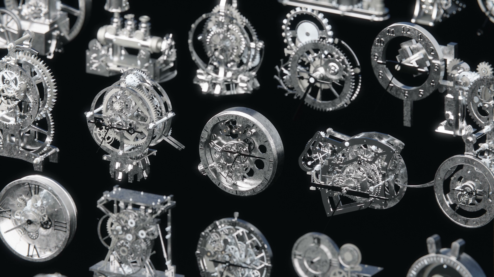
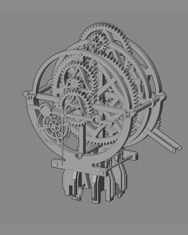
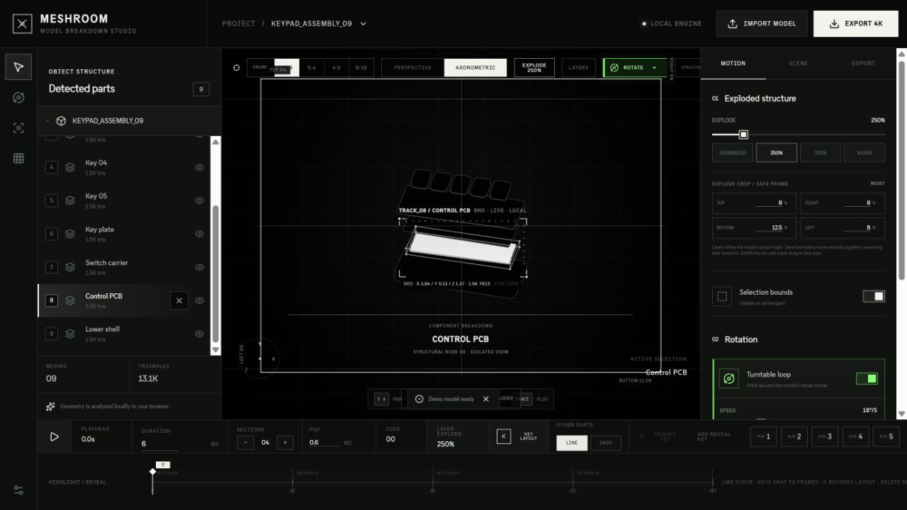
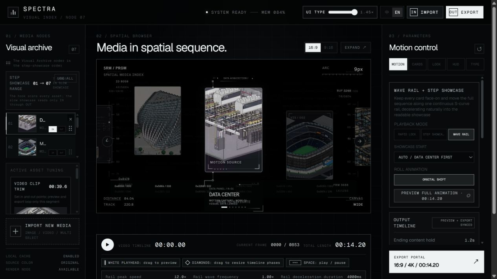

# Creative Workflows / Muwen Li

I design tools and reusable workflows for visual creation, from mechanical assets and controllable motion to browser-based creative interfaces.

**7 projects · Blender assets, architectural animation and browser-based creative tools**

## Selected work

**Project** opens the project overview and process. **Open** takes you directly to the product or interactive app. Each case explains the design problem, the workflow and the evidence available to review.

| Project | Problem → approach | Format | Open |
| --- | --- | --- | --- |
| **01 · [Steampunk Clockwork](https://github.com/MuwenTriLi/steampunk-clockwork-showcase)** | Repeated mechanical setup → reusable assemblies & editable motion | Blender assets + Skill | [Superhive product ↗](https://superhivemarket.com/products/steampunk-clockwork-animated-assets) |
| **02 · [Model Breakdown Studio](https://github.com/MuwenTriLi/model-breakdown-studio)** | Hard-to-read 3D assemblies → explode, isolate & explain | Browser tool | [Open web app ↗](https://meshroom-breakdown-studio.limuwen9.chatgpt.site) |
| **03 · [Blue / White Architecture Growth](projects/blue-white-architecture-growth.md)** | Dense architectural scenes → consistent style & staged growth | Blender workflow | Media pending |
| **04 · [Collage Motion](projects/03-collage-motion.md)** | Repetitive collage layout & timing → grid and rhythm controls | Browser tool | [Open web app ↗](https://muwentrili.github.io/creative-workflows/collage-motion/) |
| **05 · [FLIPFRAME](projects/04-flipframe.md)** | Media sequencing & pacing → editable spatial presentation | Browser tool | [Open web app ↗](https://flipframe-motion-lab.limuwen9.chatgpt.site) |
| **06 · [VOX / ONE](projects/05-vox-one.md)** | Speech/type synchronization → editable timed typography | Browser tool | [Open web app ↗](https://vox-one.limuwen9.chatgpt.site) |
| **07 · [TRACE / 01](projects/06-trace-01.md)** | Moving subjects need context → tracking & readable overlays | Browser tool | [Open web app ↗](https://trace-01-motion-tracker.limuwen9.chatgpt.site) |

**Try first:** Model Breakdown Studio and Collage Motion include built-in examples. All five browser tools have public entrances; VOX / ONE and TRACE / 01 need your own input media. Architecture Growth currently has a written case framework, with video to follow.

## 01 / Clockwork — detail preview

**46 animated assets · Linked mechanisms · Editable controls**

<table>
<tr>
<td width="46%" align="center" valign="top"> <b>Collection overview</b> Original render · clocks and mechanical assemblies</td>
<td width="27%" align="center" valign="top"> <b>Motion study</b> Animated turntable · exposed movement</td>
<td width="27%" align="center" valign="top"> <b>Controlled opening</b> Linked mechanism · adjustable speed and phase</td>
</tr>
</table>

My design direction and model collection became a reusable Blender library, with Codex-assisted development. The documented workflow connects component inspection, control adjustments and modular reuse.

[Full case study](https://github.com/MuwenTriLi/steampunk-clockwork-showcase) · [Control reference](https://github.com/MuwenTriLi/steampunk-clockwork-showcase/blob/main/docs/controls.md) · [Workflow + Skill](https://github.com/MuwenTriLi/steampunk-clockwork-showcase/blob/main/docs/workflow-skill.md)

## 02 / Model Breakdown Studio — interactive preview

<table>
<tr>
<td width="48%" valign="top"></td>
<td width="52%" valign="top"><b>Turn a 3D model into an explanation.</b>  Inspect components, compose an exploded view, highlight parts and arrange motion.  <b><a href="https://meshroom-breakdown-studio.limuwen9.chatgpt.site">Open the interactive app →</a></b> No sign-in required. A built-in model is ready to try.  <a href="https://github.com/MuwenTriLi/model-breakdown-studio">Read the case study</a> · <a href="https://github.com/MuwenTriLi/model-breakdown-studio#try-it-in-one-minute">One-minute walkthrough</a></td>
</tr>
</table>

## 04–07 / Four different creative problems

| [Collage Motion](projects/03-collage-motion.md) | [FLIPFRAME](projects/04-flipframe.md) | [VOX / ONE](projects/05-vox-one.md) | [TRACE / 01](projects/06-trace-01.md) |
| --- | --- | --- | --- |
|  |  |  |  |
| Layout & rhythm | Sequence & pacing | Speech & type | Tracking & annotation |

These are current editor views. Each project page provides the problem, design choices, a short walkthrough and verification limits. Selected final films and process recordings will be added as they are prepared; no measured efficiency or user-study results are claimed.

## Where to find things

- **This repository** is the portfolio index. The [projects folder](projects/) contains the browser-tool case studies and the architecture-growth framework, with current evidence and access information where available.
- **[Model Breakdown Studio](https://github.com/MuwenTriLi/model-breakdown-studio)** links to the original interactive web app and contains the project presentation, walkthrough outline and recording folder.
- **[Clockwork case study](https://github.com/MuwenTriLi/steampunk-clockwork-showcase)** contains the renders, motion gallery, controls, design process and commercial product link.
- **[Clockwork workflow + Skill](https://github.com/MuwenTriLi/steampunk-clockwork-showcase/blob/main/docs/workflow-skill.md)** explains the reusable method. [SKILL.md](https://github.com/MuwenTriLi/steampunk-clockwork-showcase/blob/main/skills/clockwork-assembly/SKILL.md) contains the actual instructions.

Projects 01–05 are the first preparation group; 06–07 follow. Architecture-growth details and media are pending. Numbers indicate portfolio order. Clockwork, Model Breakdown Studio and this index are public. The browser tools are interactive prototypes; their pages distinguish available controls from verified outcomes. The Clockwork instruction Skill has not yet been tested end to end on a new Blender task.
