# 01 / Clockwork

[Product page · Superhive](https://superhivemarket.com/products/steampunk-clockwork-animated-assets)

Original modeled components developed into **46 animated Blender assets** with linked mechanisms and editable controls.

Tech stack: Blender geometry, native drivers, hierarchies and constraints; Codex-assisted inspection and implementation.

## Visual overview

[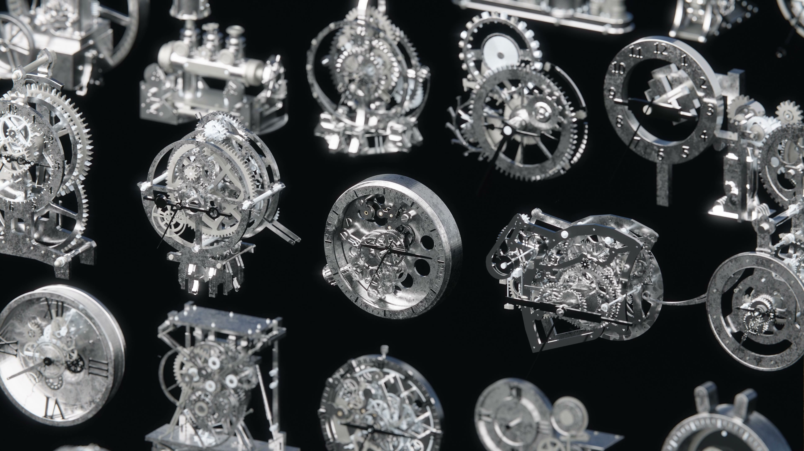](media/collection-hero-4k.jpg)

The finished collection, motion excerpts and Blender recordings below show different aspects of the same work. Click a still for its full image or a recording for playback.

### Structure → material

The same collection presented with two visual priorities: **linework exposes construction; rendered surfaces show the finished design language**.

<a href="media/structure-material-comparison.jpg">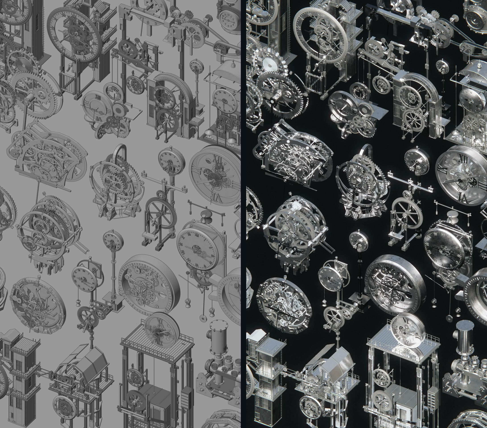</a>

[Open the paired comparison](media/structure-material-comparison.jpg) · [Full-resolution linework](media/structure-pass.jpg) · [Full-resolution render](media/material-pass.jpg)

Frames from the two original collection videos. Their motion phases differ; this is a presentation comparison, not a controlled user study.

### The collection in motion

### Mechanisms in focus

Two larger studies expose the movement behind the overall silhouette. Click a preview to inspect its five-second excerpt.

<a href="media/differential-motion.gif">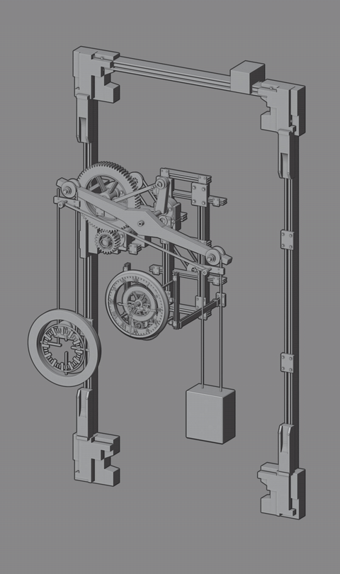</a>

<em>Left to right:</em> <b>SPM14 / suspended mechanism</b> — Read the suspended parts, linkages and counterweight together.; <b>CLK31 / guided movement</b> — Read the relationship between the dial, structure and rail path.

[More videos and Blender recordings →](docs/showcase-films.md) · [All 24 motion studies →](docs/motion-library.md#24-clock-motion-studies)

### Motion is part of the design

Two ways to read a mechanism: rotate the whole form to understand its construction, then hold the view still to inspect how its parts move.

#### 01 / Rotating views

<em>Left to right:</em> <b>Clock 01</b> — Turntable / Layered dial; <b>Clock 03</b> — Turntable / Stacked gears; <b>Clock 07</b> — Turntable / Exposed movement; <b>Clock 08</b> — Turntable / Skeleton frame

The silhouette stays readable as gears, shafts and supporting frames come into view.

 

#### 02 / Fixed views · moving mechanisms

<a href="media/motion-clk31.gif">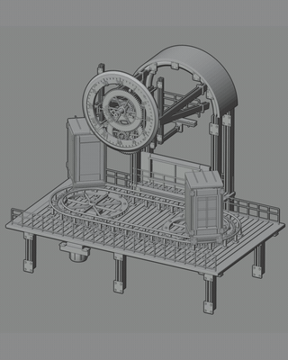</a>

<em>Left to right:</em> <b>Clock 10</b> — Motion / Framed gear train; <b>Clock 15</b> — Motion / Vertical linkages; <b>Clock 23</b> — Motion / Rail-guided motion; <b>Clock 24</b> — Motion / Unfolding canopy

A steady view makes the relationships between rotation, travel and opening easier to judge.

[Explore all 24 motion studies →](docs/motion-library.md#24-clock-motion-studies) · [Original asset IDs](docs/clock-index.md)

Clock numbers indicate the presentation order. GIFs repeat short excerpts at the original playback speed; they are not guaranteed seamless cycles.

### Selected forms

Finished renders for inspecting materials and small details; the motion studies above show how the assemblies move.

<a href="media/clk18.png">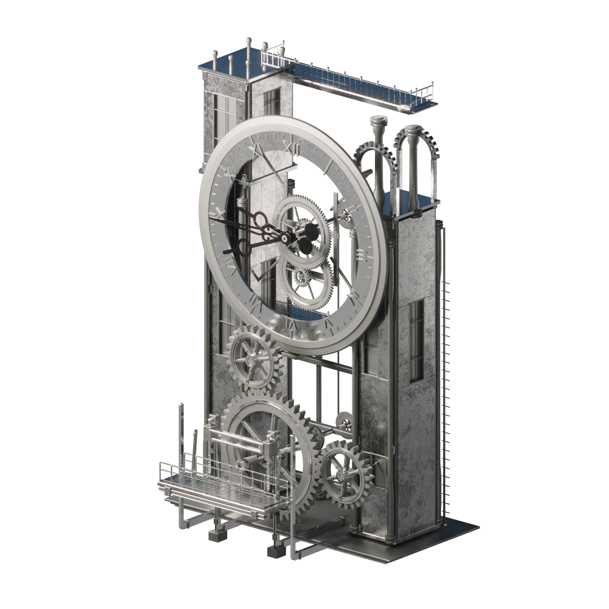</a>

<a href="media/aperture.png">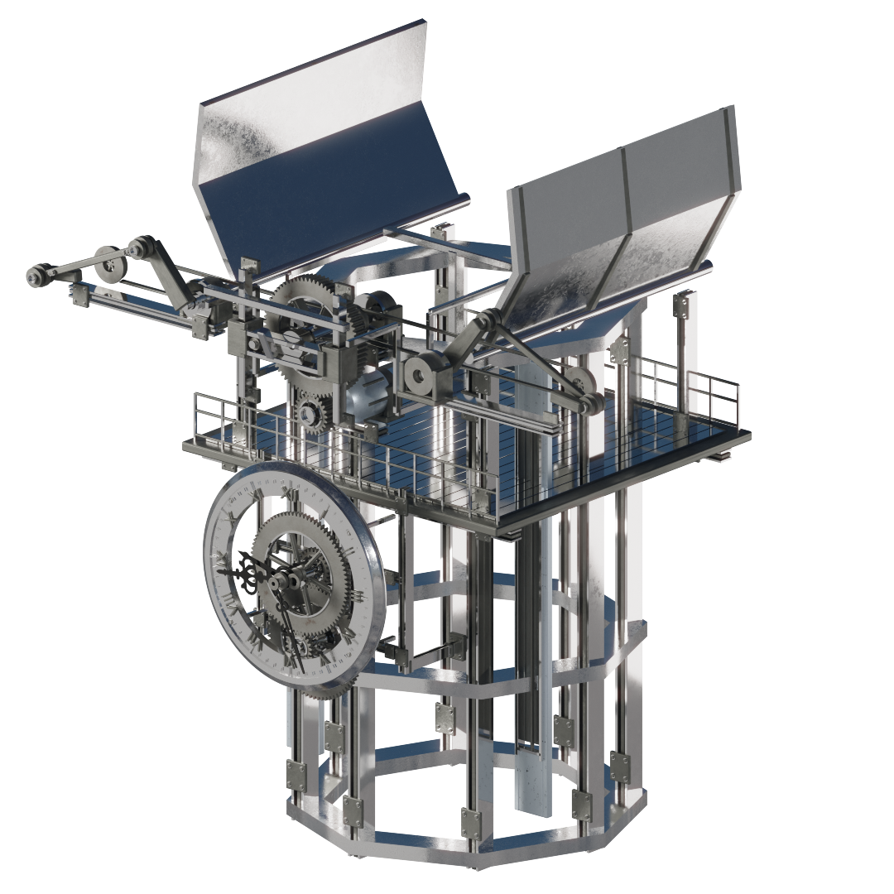</a>
<a href="media/chain-drive.png">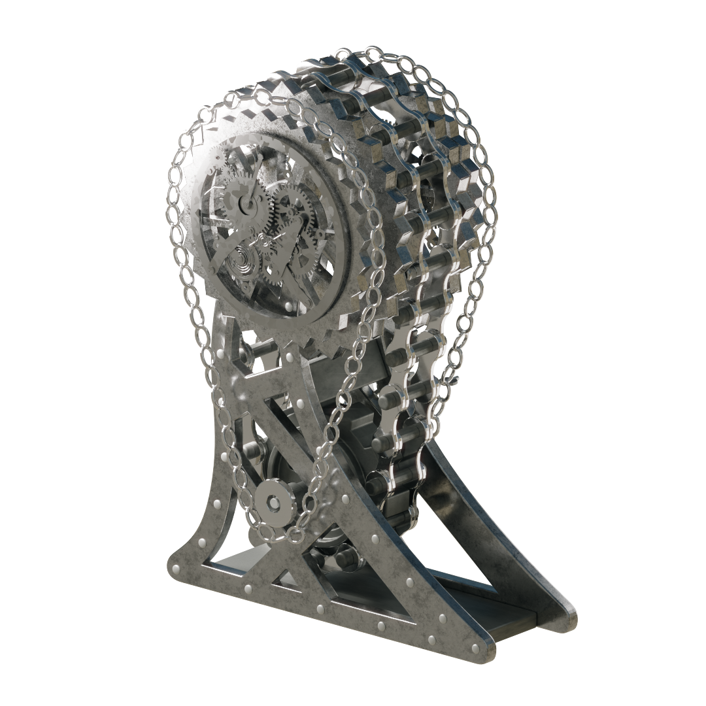</a>

<em>Left to right:</em> <b>CLK18 / vertical linkages</b>; <b>CLK31 / rail-guided assembly</b>; <b>CLK32 / unfolding canopy</b>; <b>SPM03 / chain drive</b>

#### Eight more rendered forms

<a href="media/clk02.png">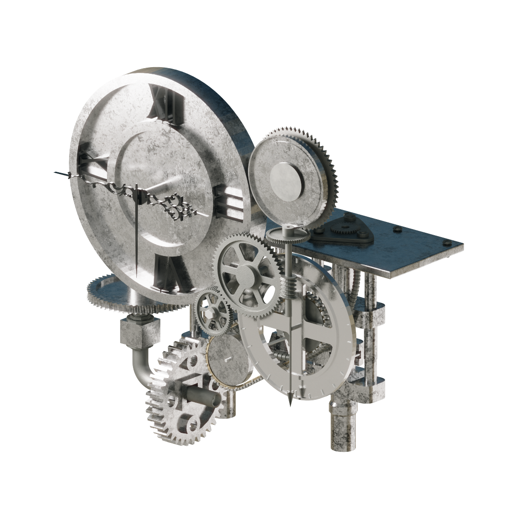</a>
<a href="media/clk03.png">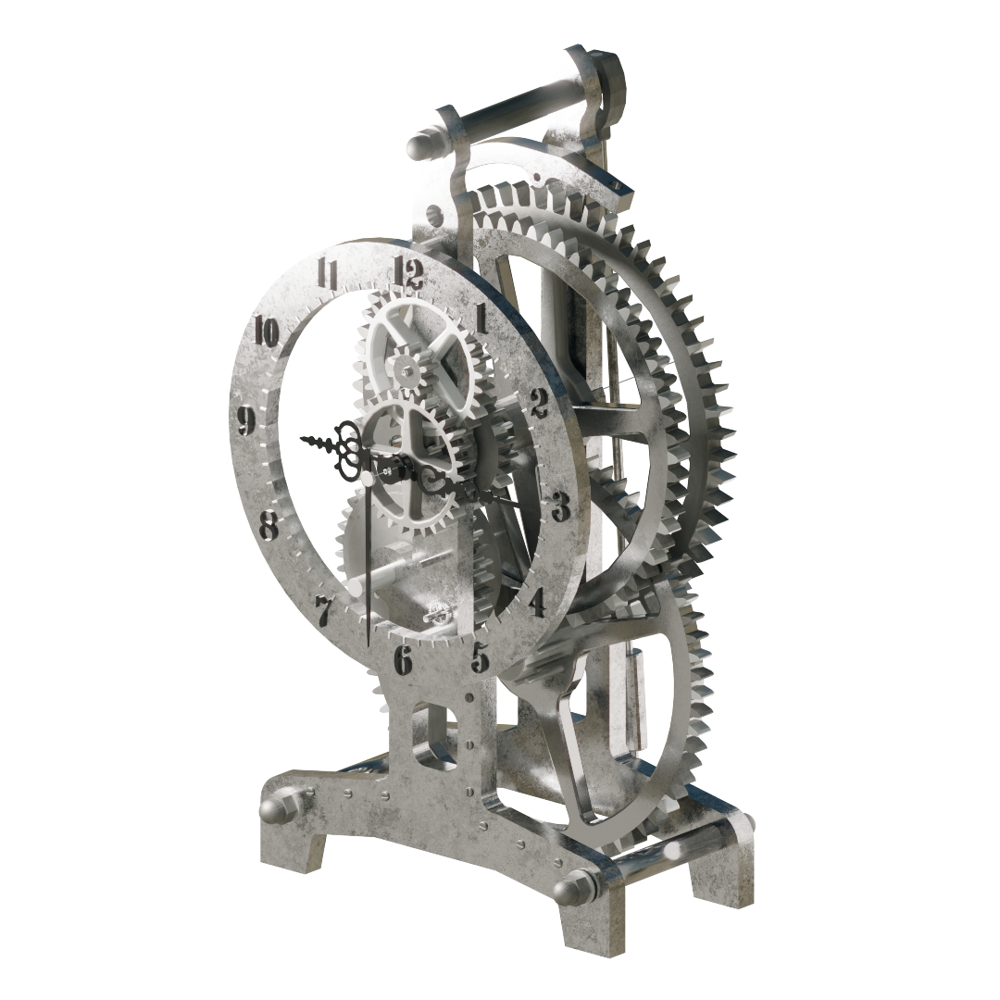</a>
<a href="media/clk04.png">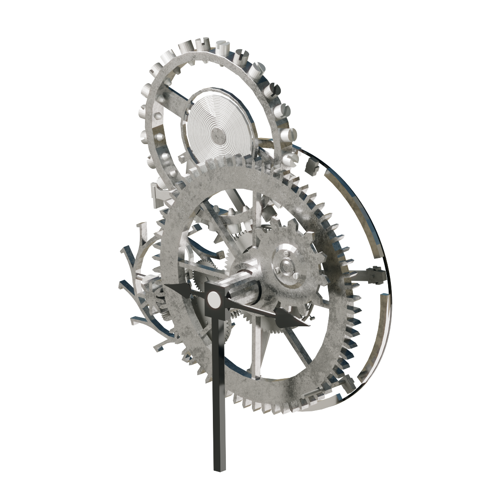</a>

<em>Left to right:</em> <b>CLK02</b>; <b>CLK03</b>; <b>CLK04</b>; <b>CLK06</b>

<a href="media/clk12.png">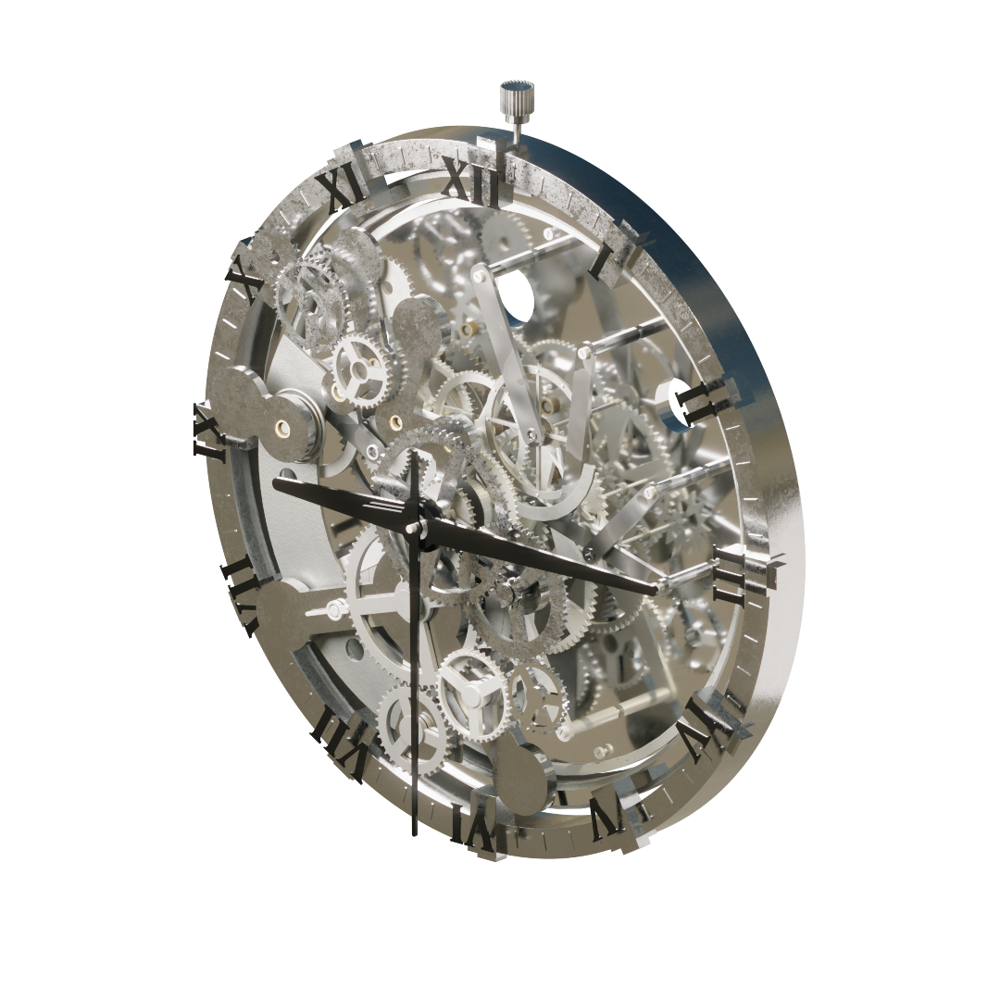</a>

<em>Left to right:</em> <b>CLK08</b>; <b>CLK10</b>; <b>CLK11</b>; <b>CLK12</b>

Click any render to inspect it. [Browse all clocks and selected mechanisms →](docs/render-gallery.md)

### Inside Blender: from library to moving assembly

<a href="https://muwentrili.github.io/creative-workflows/films/?project=clockwork&amp;film=library-placement">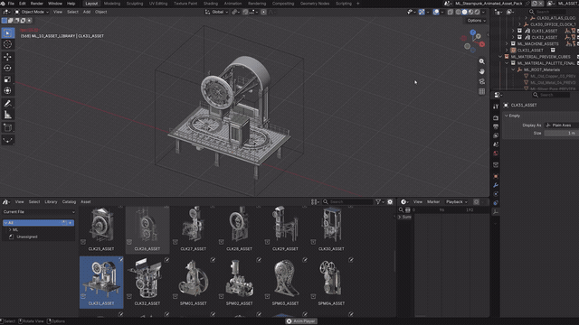</a>

<em>Left to right:</em> Inspect the opening mechanism; Browse and place an asset

[Opening mechanism · MP4](https://muwentrili.github.io/creative-workflows/films/?project=clockwork&film=opening-in-blender) · [Asset placement · MP4](https://muwentrili.github.io/creative-workflows/films/?project=clockwork&film=library-placement) · [Seven videos and recordings](docs/showcase-films.md)

These original viewport recordings show the working scene and library. The Evidence section includes a checked CLK32 speed-change video; neither establishes every parameter or arbitrary recomposition.

### Browse the library in Blender

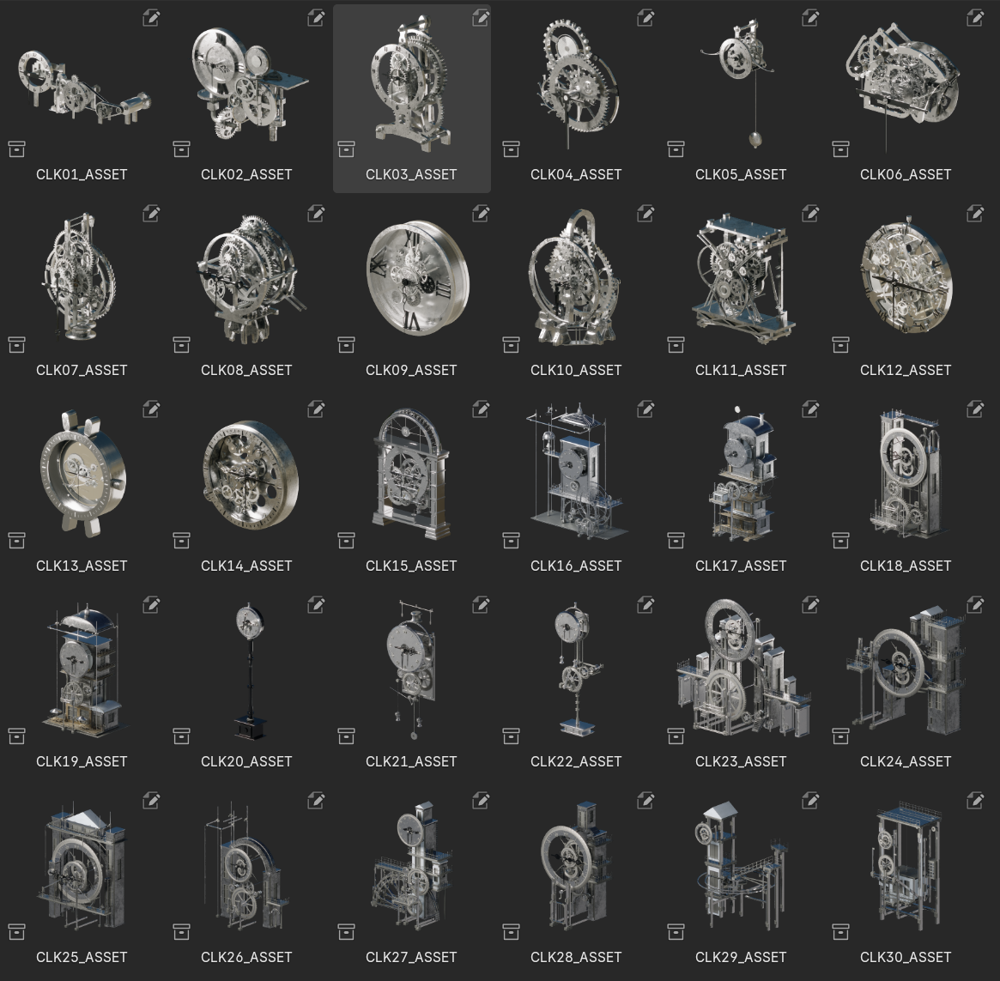

[Watch the Blender library tour](https://muwentrili.github.io/creative-workflows/films/?project=clockwork&film=blender-library-tour) to see the assets in the working viewport.

[Full render gallery](docs/render-gallery.md) · [All 24 motion studies](docs/motion-library.md) · [Seven films and viewport recordings](docs/showcase-films.md). These retain the larger galleries and their original asset IDs.

## Workflow and creator control

Original modeled geometry and motion references became a 46-asset Blender library with linked mechanisms and editable controls. Codex assisted source inspection and linkage development; native Blender drivers and constraints run the animation.

The central task is adaptation: preserve the linked movement while changing a mechanism's pace or placing it in another composition. Native drivers propagate the chosen inputs; the creator retains form, motion intent, speed, phase and acceptance.

A detailed mechanism is only part of a usable asset. A creator also needs to place it in a composition, change the rhythm and preserve connected motion. This problem framing comes from production practice; it is not a completed customer study.

| Stage | Project contribution | System / AI assistance |
| --- | --- | --- |
| Prepare | Model the original geometry; organize source files, references and motion requirements | Inspect the supplied structures within that brief |
| Develop | Direct gear, frame and linkage relationships; review the result | Assist linked motion through native Blender drivers, hierarchies and constraints |
| Expose controls | Choose useful adjustments, such as speed, phase and clock behavior | Propagate accepted inputs through connected components |
| Deliver | Select assemblies, previews, instructions and visual evidence | Assist packaging and record a reusable inspection/adaptation procedure |

### Components for a new design

The library works at three levels: **complete animated assemblies**, **editable parts and subassemblies**, and **reusable procedural materials**. A clock can anchor a scene; its gears, frames and decorative structures can also inform a new design or visual direction.

For a working animated module, retain its controller, hierarchy and driver dependencies. For a new visual composition, duplicate the asset, make its collection instance real and adapt selected geometry or materials. A separated component may need its motion relationships rebuilt. [Component reuse workflow](docs/component-reuse.md).

### A control system behind each assembly

Built-in settings drive motion through native Blender drivers, object hierarchies and constraints. Adjust the root controller; the connected parts follow their existing relationships.

**Controller inputs -> linked motion -> moving components**

| What you want to change | Example controls | What they affect |
| --- | --- | --- |
| Chain movement | SPM03 / `Chain_Drive_Speed` | Chain speed, alongside the assembly's overall speed and phase settings. |
| Gear rotation | CLK08 / `Gear_Display_Speed` | Visible mechanism speed; clock-hand timing has separate controls. |
| Opening and folding rhythm | CLK32 / `Master_RPM`, `Speed_Scale`, `Phase_Deg` | The input speed and phase driving the unfolding mechanism. |
| Travel along an existing path | CLK31 / `Master_RPM`, `Speed_Scale` | The pace of the connected rail mechanism. |
| Clock behavior | CLK08 / `Start_Hour`, `Start_Minute`, `Start_Second`, `Second_Tick_Blend` | Initial time and smooth or stepped seconds. |
| Gear detail on supported assets | CLK31 / CLK32 / `Teeth_Multiplier` | Linked tooth density at 1 / 2 / 3, with pitch radii and transmission ratios retained. |

Controls vary by asset. Opening angles and positions may be calculated outputs, so adjustments belong upstream in the controller. [Explore the controls](docs/controls.md).

## Try one useful task

Use a working copy of CLK32 to slow the opening while keeping its mechanism intact:

1. Place the complete collection and select `CLK32_ASSET_CTRL`.
2. Record the original values. Leave `Master_RPM = 3.2` and change `Speed_Scale` from **1.0 to 0.75**.
3. Keep the hierarchy, driver targets, camera and unrelated geometry intact. `Input_Angle` is a calculated result, not the speed input to edit.
4. Preview the full intended frame range and restore the recorded value if the motion no longer serves the shot.

This is the bounded change recorded in the Evidence section. Recomposition or dependency changes require their own checks. [Exact procedure and measured result](docs/control-study.md).

## Setup and reuse

The Blender library is distributed through the Superhive page above. This project folder contains its public documentation and presentation evidence; it does not include the source `.blend` library or change its license.

Register the supplied Asset Library folder in Blender, place a complete collection and select its root controller. Adjust an input documented for that asset, preserve its dependencies and review a complete motion cycle. [Controller reference](docs/controls.md) explains the differences between assets.

The supplied package documents Blender **5.2.0 LTS / Windows / Cycles**. The later CLK32 study also used Blender 5.2; a first attempt on 5.0.1 found incompatible modifier paths. This is not a claim of universal version compatibility. No add-on is required to use the native model library.

| Included | Delivery |
| --- | --- |
| Animated assets | 32 clocks and 14 mechanical assemblies |
| Asset Browser | 46 categorized custom previews |
| Materials | 9 marked reusable procedural material assets |
| Presentation | 5 supplied showcase scenes |
| Documentation | Setup, controller reference and recorded checks |

For animated reuse, retain the controller, hierarchy and targets together. For geometry-only reuse, work on a duplicate and inspect any links that must be rebuilt. [Component reuse](docs/component-reuse.md) describes these different cases.

## Evidence and next step

### One checked change: slower opening

[Play the 10-second speed comparison — 1.0 versus 0.75](media/control-study/clk32-speed-comparison.mp4). Watch the opening over time: both versions use the same camera and frame range, with only `Speed_Scale` changed. This diagnostic render documents one control adjustment separately from the finished product imagery.

The CLK32 change retained **81 object drivers**, checked **601 frames per setting**, and measured an input-angle ratio of **0.75**. The ten-second comparison decodes to 240 frames at 24 fps. These checks do not establish collision-free motion across the whole collection or arbitrary controller settings.

The package's earlier audit reports 46 assets and 2,640 drivers, but predates some later file modifications and was not rerun for this publication. [Validation scope](docs/validation.md) keeps that historical record separate from the new single-control study.

The public [adaptation Skill](skills/clockwork-assembly/SKILL.md) records inspection, a working-copy edit and verification. Broader autonomous recomposition remains unverified. Next, observe an unfamiliar creator repeating one adjustment and restoring it before claiming improved task completion or time savings.

[Build process](docs/process.md) explains the prepared inputs and AI-assisted development. [Production decisions](docs/production-case.md) records the reasoning behind the controls. Rendered media and the Blender library retain their existing rights; this public project does not grant a new asset license.
