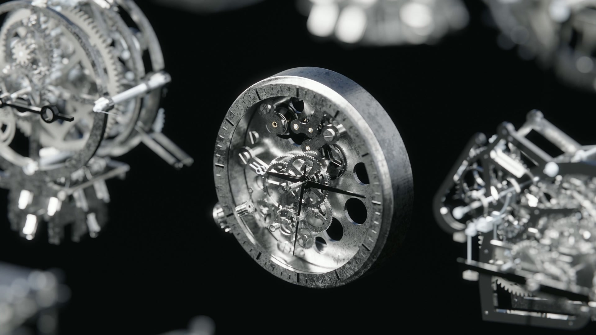
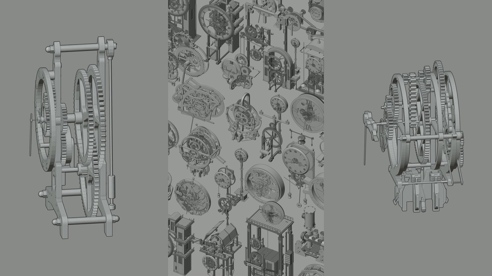
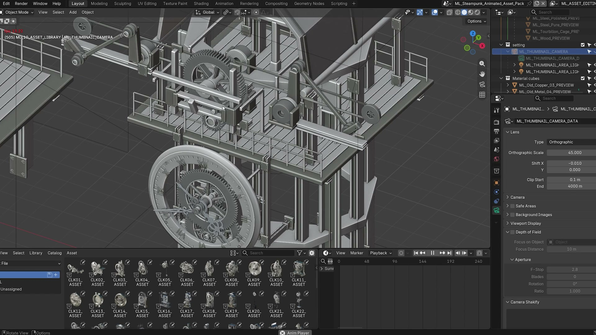

# Clockwork: three views

[← Case study](../README.md) · [24 motion studies](motion-library.md#24-clock-motion-studies) · [Render gallery](render-gallery.md) · [Source notes](media.md)

Three 15-second videos show the rendered finish, linework and workflow inside Blender. Click a preview to open the player.

## 01 / Rendered collection

Two camera views of the finished rendered collection.

[Play video · 15 s](https://muwentrili.github.io/creative-workflows/films/?project=clockwork&film=collection-tour)

## 02 / Linework collection

Three-column linework studies fill the horizontal frame with the collection and individual mechanisms.

[Play video · 15 s](https://muwentrili.github.io/creative-workflows/films/?project=clockwork&film=lineweight-collection)

## 03 / Blender testing

From the Asset Browser to opening and motion checks in Blender, using three selected recordings.

[Play video · 15 s](https://muwentrili.github.io/creative-workflows/films/?project=clockwork&film=viewport-collection)

All three viewing copies are silent. The Blender edit shows asset placement and motion checks; the separate [control-change study](control-study.md) documents a measured parameter revision.
