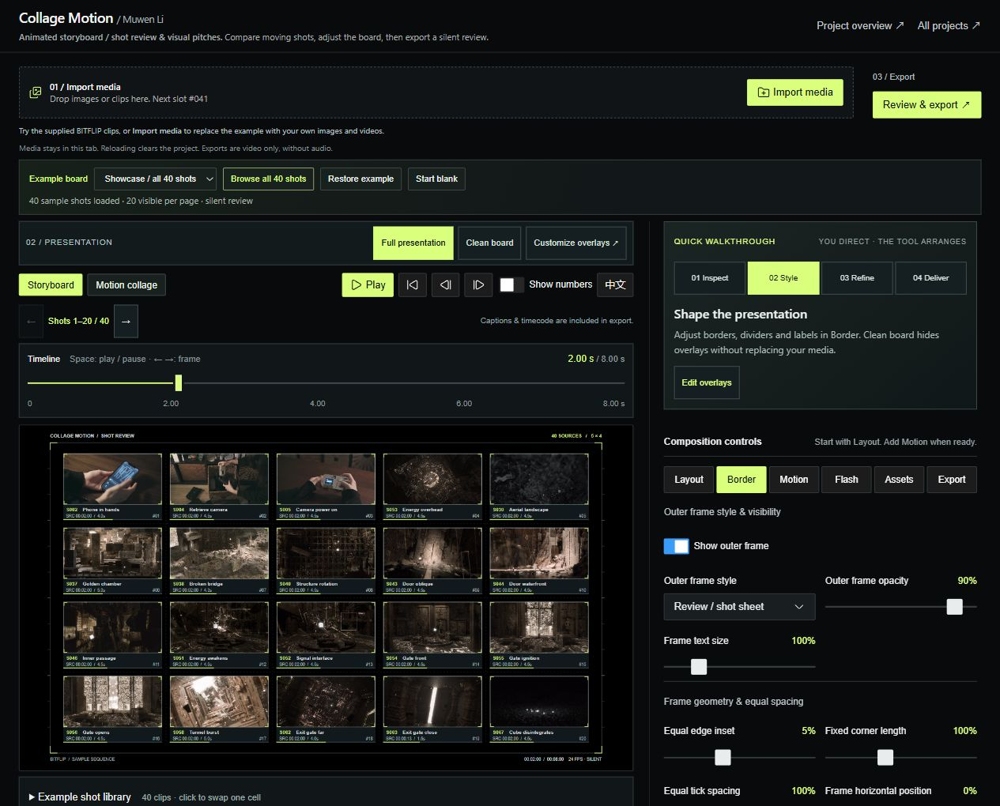
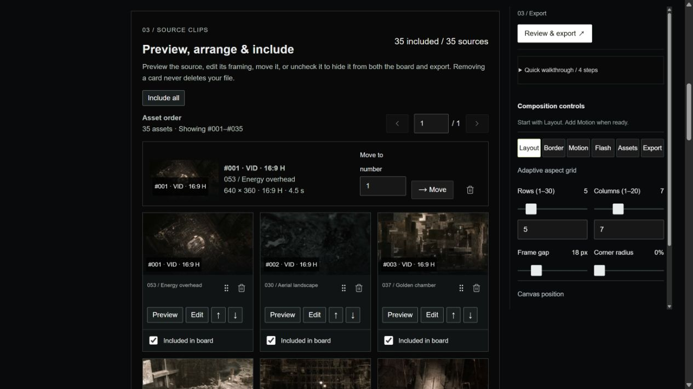

# 04 / Animated Storyboard

Previously named Collage Motion. The name now describes the main task: compare and revise moving shots on one board.

[← All projects](../README.md#selected-work)

**A moving storyboard for shot review, visual pitches and production conversations.**

I know the difficulty of discussing a visual direction through a folder of separate clips. This tool puts moving shots on one editable board, with a stable identity for each source and controls for layout, framing and presentation.

**[Open the interactive board ↗](https://muwentrili.github.io/creative-workflows/collage-motion/)** · [Watch the 8 s output](https://muwentrili.github.io/creative-workflows/collage-motion/examples/review-board-demo.mp4) · [Design demos & 4K output](https://muwentrili.github.io/creative-workflows/collage-motion/process/) · [How it works](../docs/animated-storyboard-handoff.md) · [Source](../docs/collage-motion/) · [Local demo release](../docs/distribution.md)

*Actual editor export. The default is the 35-shot selection supplied for this portfolio, arranged 7 × 5. The clips move together, silently; this is a parallel review board, not a sequential edit.*

## A complete starting point

The workspace shares Model Breakdown's restrained typography, rectangular controls and input–preview–inspector structure. A visitor sees the intended result before importing anything.

| Step | Try it | Creator decision |
| --- | --- | --- |
| **01 / Input** | Inspect the 35-shot example or use **Import media** | Choose the material and purpose of the review |
| **02 / Presentation** | Switch among six original white HUD styles or **Clean board** | Decide how much graphic context the footage needs |
| **03 / Local correction** | Select a cell, replace its source, change framing or adjust spacing | Revise the affected shot without rebuilding the board |
| **04 / Output** | **Review & export** → 4K → inspect the downloaded file | Accept framing, labels, motion and duration |

The original frame styles are Open data, Calibration, Code array, System index, Construction and Debug memory. Stable source IDs remain visible by default. `#001` identifies the current position; `S053` identifies the supplied shot. The examples do not invent shooting dates or spoken subtitles. Editable descriptions are available in the Assets controls; the chosen HUD determines which metadata is rendered.

## From production experience to product decisions

| Production problem | Implemented mechanism | Check before delivery |
| --- | --- | --- |
| Separate files interrupt comparison | One moving board with a curated opening example | The reviewer can identify and compare the intended shots |
| Dense presentation can hide the footage | Independent HUD presets, white graphic treatment and clean view | Labels and graphics do not cover the subject |
| Feedback is usually about one part | Selected-cell source replacement and framing controls | Other shots and their order remain intact |
| Many simultaneous decoders can freeze | The supplied 35-shot board uses one optimized video atlas; higher-resolution media is loaded for export | Every displayed cell actually moves, including in the encoded file |
| An encoder success message can conceal static output | Fixed-time export and decoded-frame checks | Duration, frame count and the contents of each tile match the preview |

The preview atlas is about 9.6 MB; the export atlas is about 52.7 MB. This optimization applies to the built-in example. Visitor clips use the regular local-media path and still need device-specific performance checks. A 4K board does not turn each small source tile into an individual 4K image.

## Automation and creator authority

**System:** load the selected example, arrange the grid, render accepted HUD settings, loop the media and encode the current board page.

**Creator:** choose shots, order, crop, density, timing, graphic treatment and final acceptance. The tool does not infer the story or autonomously replace content. Muwen supplied the direction, material selection and production critique; Codex assisted implementation.

**Recovery and boundaries:** replace one source or adjust one crop locally. Import replaces the sample; loading an example over personal work requests confirmation. Original files remain unchanged. Rendering locks editing and waits for media readiness. Undo and persistent project saving are not implemented: reload clears visitor edits. Output is silent and contains the board, not the surrounding editor.

## Evidence and next decision

The eight-second sample was exported from this editor at **3840 × 2160, 24 fps, 192 frames**. All 192 frames decode. Checks across the interior of every one of the 35 tiles confirm changing image content; none remains frozen through the sequence. This is a bounded result in the tested Chromium environment, not a guarantee for every device or uploaded library.

**Hypothesis:** a labeled moving board helps a creator explain visual direction with less setup and more focused revisions. No time-saving figure or user-study result is claimed.

**Next test:** ask an unfamiliar filmmaker to import five clips, make one meaningful local correction and deliver a review board without coaching. Record hesitation, assistance, actual time and the quality of the review conversation. Expand when the workflow improves that conversation; iterate if labels or controls distract; narrow the product when the real need is a sound-synchronized edit.

[Functional review](../docs/functional-review.md) · [Evidence still needed](../docs/evidence-to-add.md)

## Media and design references

The three supplied process videos are published as [earlier design demonstrations](https://muwentrili.github.io/creative-workflows/collage-motion/process/), separately labeled from the current app's export. BITFLIP footage is included for this portfolio demonstration; no separate media reuse license is granted. Visitor files stay in the browser tab.

## Source clips: inspect and revise the board

The source collection sits directly below the canvas. Preview an individual shot, select it for framing and caption edits, move it earlier or later, or enter an exact position. Uncheck **Included in board** to retain a source while excluding it from both preview and export; **Include all** restores it. Removing a card affects only this board. Bundled sources are optimized viewing copies; imported sources use the visitor's own local files.

The 35-shot example uses one shared video atlas for simultaneous board playback. Individual source playback opens on demand, so the source collection does not create another 35 live video decoders.

## Implementation and handoff

The [implementation and test map](../docs/animated-storyboard-handoff.md) connects the atlas, source-clip controls, visibility filtering and fixed-time export to the production decisions above. It includes a reproducible local correction and the exact boundary of the checks.
