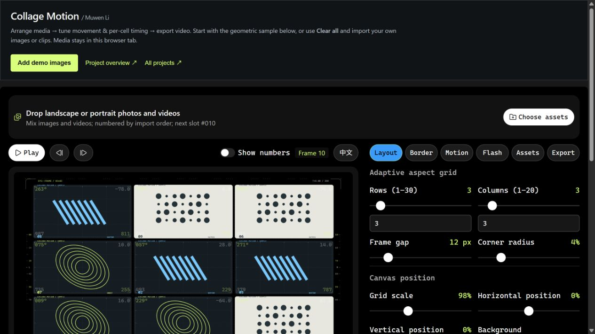
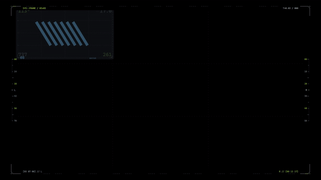

# Collage Motion

[← All projects](https://github.com/MuwenTriLi/creative-workflows#selected-work)

**04 / Browser tool · Media composition & motion**

Turn a collection of images and clips into a timed collage, with direct control over layout, movement and the rhythm of individual cells.

**[Open web app ↗](https://muwentrili.github.io/creative-workflows/collage-motion/)** · [Browse the source](../docs/collage-motion/) · [Local backup ZIP](../downloads/collage-motion-local-demo.zip)

*Live editor with procedural sample graphics. These are demonstration inputs, not a finished portfolio film.*

## The problem

An animated image wall combines two jobs: composing many differently sized assets and controlling when each one appears or changes. A new image order, grid size or pacing decision can mean revisiting many individual layers and keyframes. The creative decision is the composition and rhythm; the repetitive work is keeping all those cells coordinated.

## The approach

Put the media library, canvas and timing controls in one browser workspace. Layout rules handle the grid; reusable motion settings handle entry and sequencing; per-cell flash controls shape the transition from a quick visual burst to a readable hold. The same collection can be rearranged and previewed without rebuilding the composition.

| Creative decision | Control in the tool | Purpose |
| --- | --- | --- |
| How much content fits? | Rows, columns, spacing, scale and aspect ratio | Explore density while keeping assets legible |
| What should appear first? | Numbered asset order, reorder and randomization | Make sequencing an explicit choice |
| How should the grid move? | Motion direction, stagger, easing and grouping | Coordinate movement across cells |
| How fast should images change? | Flash timing, holds and speed curve | Balance energy with reading time |
| What needs individual attention? | Per-asset crop, position, scale and opacity | Refine one asset without changing the entire wall |

## Try it in one minute

1. Open the app in desktop Chrome. Nine geometric samples are already loaded.
2. In **Layout**, change the row or column count and compare the composition.
3. Open **Motion** or **Flash**, adjust one timing control, then use play/pause and the timeline to inspect the change.
4. To use your own media, choose **Clear all**, then **Choose assets**, or drag images/clips into the import area.
5. In **Export**, start with a short **720p MP4**. Save the result and compare it with the preview.

## Design contribution and reusable workflow

The project brings layout, sequencing and motion controls into a focused creative tool. Muwen's direction is expressed through the control model and iterative visual decisions, with Codex-assisted implementation. Reuse happens through the editor's parameters: replace the inputs, keep or change the timing recipe, and produce a new sequence.

This is a browser application with a repeatable workflow. An installable agent Skill is not included in this project.

## Exported sample

*GIF preview of the actual five-second export, using the built-in geometric sample. This demonstrates the output path; a creator-selected final example will follow.*

## Evidence and current limits

- The current demo exported a **720p, five-second H.264** MP4 with **150 frames at 30 fps**. The file was fully decoded successfully. Sample loading and grid adjustment were checked in the browser. The demo adds a sample starter, English default, navigation and a repair that prioritizes the existing WebCodecs MP4 path over the failing MediaRecorder remux path.
- Media is read through browser file inputs and object URLs; this static app has no media-upload backend. Keep originals separately: reloading clears the working session.
- Export support depends on browser codecs and device resources. Start in desktop Chrome or Edge. Long clips, large mixed-media projects and 4K output still need broader testing.
- A creator-selected finished example and narrated workflow recording will be added next. No measured time-saving or user-research result is claimed here.

## Case evidence to add

One finished collage, a short recording of changing the grid or timing, and the matching exported clip. The comparison should show what changed and why the revised rhythm communicates better.
