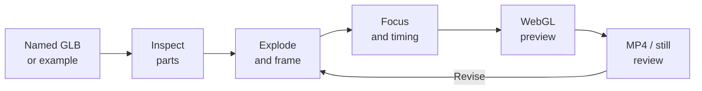

# 03 / Model Breakdown Studio

[Demo](https://meshroom-breakdown-studio.limuwen9.chatgpt.site)

**Turn a multi-part GLB into an exploded explanation with editable emphasis and timing.**

Tech stack: React, TypeScript, Three.js, WebGL, WebCodecs and mp4-muxer. This is an interactive presentation app; it does not identify semantic parts in a fused mesh.

## Workflow and creator control

Start with named, separate model parts and a component to explain. The app loads the geometry and calculates separation from its assembled pose. The creator chooses orientation, visible parts, explode amount, focal component, framing and reveal timing, then accepts or revises the result.

Muwen Li directed the interaction and visual presentation, informed by AEC production; Codex assisted implementation. Imported model authorship is separate from application authorship.

## Try one useful task

1. In the Demo, **Press Manufacturing Line** opens exploded with 32 named parts.
2. Compare **Assembled** and **Exploded view**; select one component in the part list.
3. Adjust separation and framing, then add a layout key or reveal cue. Preview the complete sequence.
4. Export a short MP4 and play it through. Check that the focal part stays legible and inside the frame.

For your own input, export a self-contained GLB with separate meshes and readable names. A merged object remains one part. Switching examples replaces the current edits after confirmation.

## Workflow diagram



## Local setup

Requirements: Git, **Node.js 22.13+**, **pnpm 11.25.0**, and a desktop browser with Canvas/WebCodecs support. Use Chrome or Edge for comparison with the recorded checks. Install Git and Node.js first, then check `git --version` and `node --version`. Package downloads need internet. No API key or hosted account is needed by this local runner.

Run these commands in PowerShell, macOS Terminal or a Linux shell:

```sh
npm install --global pnpm@11.25.0
git clone https://github.com/MuwenTriLi/creative-workflows.git
cd creative-workflows/projects/03-model-breakdown/source
pnpm install --frozen-lockfile --ignore-scripts
pnpm verify:source
pnpm dev --port 5173 --strictPort
```

Open **http://127.0.0.1:5173/**. Stop the server with Ctrl+C. If 5173 is occupied, stop the other server or choose another port. To check the production bundle:

```sh
pnpm test
pnpm build
pnpm preview --port 4173 --strictPort
```

Open **http://127.0.0.1:4173/** for the built app. Keep the tab in the foreground during export. Try a short FHD output before 4K; a successful build does not establish codec support or available GPU memory on another computer.

The three example GLBs and Draco decoder are bundled. `pnpm test` checks geometry, example integrity and exploded-layout behavior; it does not render a video. The snapshot matches hosted client version **31**. Models with more geometry or unusual hierarchies need separate checks.

The [source manifest](source/source-manifest.json) records the hosted revision and hashes; `verify:source` checks the copied client files. The local Vite runner replaces the hosting wrapper. Public navigation links still open the hosted studios. [Source and media rights](source/RIGHTS.md) apply independently of these setup instructions.

## Features and implementation

- Three bundled examples and local GLB import; named parts remain selectable.
- Assembled/exploded views, emphasis and timed layout/reveal controls.
- Technical line presentation with editable framing and aspect ratio.
- Browser-side output; importing your own model does not publish it to GitHub.

The client is in [source/app/page.tsx](source/app/page.tsx). [example-models.ts](source/app/example-models.ts) loads the bundled geometry; [explode-layout.ts](source/app/explode-layout.ts) handles separation and nested transforms. A future handoff should further isolate scene state, timeline evaluation and encoding. General undo and automatic semantic grouping are not established features.

## Evidence and next step


[Selected output films](https://muwentrili.github.io/creative-workflows/model-breakdown-films/) show complete presentation sequences. The separately recorded synthetic and real Press-model tests each produced **2 seconds, 3840 × 2160, 30 fps, 60 decoded frames**. These are bounded checks; they do not prove arbitrary imports or universal GPU compatibility. [Model and export evidence](docs/example-model-review.md).

Next: observe an unfamiliar creator importing a model, making one framing correction and exporting. Iterate import and correction feedback before expanding format support. No creator time-saving or usability result is claimed.

This folder is the current project home. Its `source/` contains the current browser snapshot and local runner. The earlier MIT local adaptation remains in the historical Model Breakdown repository and is distinct from this snapshot; no new license is inferred from moving files.
