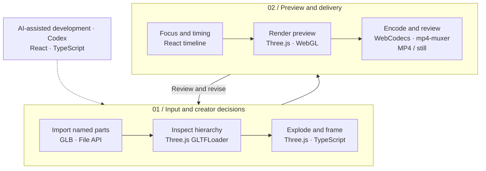

# 03 / Model Breakdown Studio

[Demo](https://meshroom-breakdown-studio.limuwen9.chatgpt.site)

**Turn a multi-part GLB into an exploded explanation with editable emphasis and timing.**

Tech stack: React, TypeScript, Three.js, WebGL, WebCodecs and mp4-muxer. This is an interactive presentation app; it does not identify semantic parts in a fused mesh.

## Visual overview

[](https://meshroom-breakdown-studio.limuwen9.chatgpt.site)

The live studio opens with a selectable, exploded **Press Manufacturing Line**. Its model selector also includes **Wood House** and **Car Production Line**. The finished films below are separately supplied output examples; they are not a new export test of the current source snapshot.

### Complete presentation sequences

Click an animated preview to watch the complete sequence. All four previews retain the source timing.

<p align="center">
<a href="https://muwentrili.github.io/creative-workflows/films/?project=model&amp;film=structure"></a>
<a href="https://muwentrili.github.io/creative-workflows/films/?project=model&amp;film=residence"></a>
</p>

<p><em>Left to right:</em> <b>Structural hierarchy</b> — Structure within an exploded assembly. — <a href="https://muwentrili.github.io/creative-workflows/films/?project=model&amp;film=structure">Watch 11 s MP4</a>; <b>Residential assembly</b> — Detail with the full model as context. — <a href="https://muwentrili.github.io/creative-workflows/films/?project=model&amp;film=residence">Watch 9.5 s MP4</a></p>

<p align="center">
<a href="https://muwentrili.github.io/creative-workflows/films/?project=model&amp;film=systems"></a>
<a href="https://muwentrili.github.io/creative-workflows/films/?project=model&amp;film=tower"></a>
</p>

<p><em>Left to right:</em> <b>Building systems</b> — Component emphasis and spatial relationships. — <a href="https://muwentrili.github.io/creative-workflows/films/?project=model&amp;film=systems">Watch 11.5 s MP4</a>; <b>Tower elements</b> — Sequential explanation of levels and envelope. — <a href="https://muwentrili.github.io/creative-workflows/films/?project=model&amp;film=tower">Watch 8 s MP4</a></p>

### One assembly / four component highlights

Each still emphasizes a different component in white, while the surrounding assembly remains in linework. The shared view makes the change of focus easy to compare. These are separately supplied still exports; click a frame to inspect the detail.

<p align="center">
<a href="showcase/media/detail-6.jpg"></a>
<a href="showcase/media/detail-7.jpg"></a>
<a href="showcase/media/detail-8.jpg"></a>
<a href="showcase/media/detail-9.jpg"></a>
</p>

<p><em>Left to right:</em> <b>Moving assembly</b> · <b>Press frame</b> · <b>Trim / inspection</b> · <b>Machine housings</b></p>

## Workflow and creator control

Start with named, separate model parts and a component to explain. The app loads the geometry and calculates separation from its assembled pose. The creator chooses orientation, visible parts, explode amount, focal component, framing and reveal timing, then accepts or revises the result.

A complete assembly can hide the part that matters. Separation is useful only when the focal component remains understandable in relation to the whole. It supports explanations for architecture, engineering and construction (AEC) or industrial design; it does not validate engineering feasibility or building information modeling (BIM) coordination.

| Input | Useful output |
| --- | --- |
| Named GLB parts + focal component | Exploded parts with focused emphasis |
| View, format + reveal order | Timed presentation or still |

The system handles geometry loading, hierarchy extraction, view fitting and separation calculations. The creator owns the explanation and final composition. Per-part semantic locks, automatic story planning and revision rollback are not established capabilities.

## Try one useful task

1. In the Demo, **Press Manufacturing Line** opens exploded with 32 named parts.
2. Compare **Assembled** and **Exploded view**; select one component in the part list.
3. Adjust separation and framing, then add a layout key or reveal cue. Preview the complete sequence.
4. Export a short MP4 and play it through. Check that the focal part stays legible and inside the frame.

For your own input, export a self-contained GLB with separate meshes and readable names. A merged object remains one part. Switching examples replaces the current edits after confirmation.

## Workflow diagram



Codex assisted development. The runtime stages above use browser code; they do not call a generative AI model.

## Local setup

[Windows verification — October 28, 2026](../../docs/local-setup-check.md).

Requirements: Git, **Node.js 22.13+**, **pnpm 11.25.0**, and a desktop browser with Canvas/WebCodecs support. Use Chrome or Edge for comparison with the recorded checks. Install Git and Node.js first, then check `git --version` and `node --version`. Package downloads need internet. No API key or hosted account is needed by this local runner.

Windows can run this directly in PowerShell; Windows Subsystem for Linux (WSL) and Cursor are optional. The same commands also work in macOS Terminal or a Linux shell:

```sh
npm install --global pnpm@11.25.0
git clone https://github.com/MuwenTriLi/creative-workflows.git
cd creative-workflows/projects/03-model-breakdown/source
pnpm install --frozen-lockfile --ignore-scripts
pnpm verify:source
pnpm dev --port 5173 --strictPort
```

Open **http://127.0.0.1:5173/**. Stop the server with Ctrl+C. If 5173 is occupied, stop the other server or choose another port. To check the production bundle:

```sh
pnpm test
pnpm build
pnpm preview --port 4173 --strictPort
```

Open **http://127.0.0.1:4173/** for the built app. Keep the tab in the foreground during export. Try a short FHD output before 4K; a successful build does not establish codec support or available GPU memory on another computer.

The three example GLBs and Draco decoder are bundled. `pnpm test` checks geometry, example integrity and exploded-layout behavior; it does not render a video. The snapshot matches hosted client version **31**. Models with more geometry or unusual hierarchies need separate checks.

The [source manifest](source/source-manifest.json) records the hosted revision and hashes; `verify:source` checks the copied client files. The local Vite runner replaces the hosting wrapper. Public navigation links still open the hosted studios. [Source and media rights](source/RIGHTS.md) apply independently of these setup instructions.

## Features and implementation

### Choose an example or prepare your own model

| Example | Named mesh parts | Compressed download |
| --- | ---: | ---: |
| Wood House | 18 | 0.1 MB |
| Press Manufacturing Line | 32 | 5.6 MB |
| Car Production Line | 30 | 14.7 MB |

Press Manufacturing Line starts at 1500% explode. Changing examples asks before replacing part edits and the timeline; cancellation retains the current work. The supplied geometry is not an automatic substitute for a failed personal import.

For a new GLB, keep independently highlighted or animated parts as separate meshes with readable names. Check units, scale and orientation, embed required resources and reopen the export before using it. A merged mesh stays one part. Technical outlines and highlights are the presentation treatment; final render materials are not the goal.

### Controls and design decisions

| Creative decision | Current interaction | What to inspect |
| --- | --- | --- |
| Which subsystem matters? | Named component list and part selection | Names identify the intended geometry |
| How much context is needed? | Assembled / exploded view and separation amount | The part remains related to the assembly |
| Where should attention go? | Highlight, orientation, rotation and framing | The focal component is visible and inside the frame |
| When should it be explained? | Layout keys and reveal timing | The sequence gives the component time to read |
| Is the output ready? | Preview, still and MP4 export | Inspect the encoded result, not only the canvas |

Change the explode amount, selected part or framing in the loaded scene before considering a new import. Satisfying an encoder does not prove that the explanation reads clearly.

### Source responsibilities

| Responsibility | File |
| --- | --- |
| Interaction, presentation state and timeline | [page.tsx](source/app/page.tsx) |
| Bundled model loading and integrity | [example-models.ts](source/app/example-models.ts) |
| Separation and nested transforms | [explode-layout.ts](source/app/explode-layout.ts) |

A future handoff should further isolate scene state, timeline evaluation and encoding. General undo and automatic semantic grouping are not established features.

## Evidence and next step

[Selected output films](https://muwentrili.github.io/creative-workflows/model-breakdown-films/) show complete presentation sequences. The separately recorded synthetic and real Press-model tests each produced **2 seconds, 3840 × 2160, 30 fps, 60 decoded frames**. These are bounded checks; they do not prove arbitrary imports or universal GPU compatibility. [Model and export evidence](docs/example-model-review.md).

Next: observe an unfamiliar creator importing a model, making one framing correction and exporting. The deliverable should keep the focal part legible, preserve its relationship to the whole and maintain continuous transitions and timing through the encoded file. Record assistance and correction effort before claiming efficiency.

Iterate orientation, naming and framing feedback when they block that task; narrow input support when there is no meaningful part hierarchy. The [recording outline](showcase/walkthrough.md) specifies the missing input-to-correction evidence. No creator time-saving or usability result is claimed.

This folder is the current project home. Its `source/` contains the current browser snapshot and local runner. The earlier MIT local adaptation remains in the historical Model Breakdown repository and is distinct from this snapshot; no new license is inferred from moving files.
