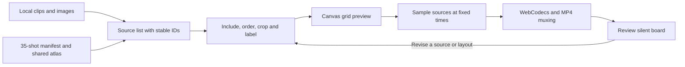

# 04 / Animated Storyboard

[Demo](https://muwentrili.github.io/creative-workflows/collage-motion/)

**Compare separate clips on one moving board, revise the shot selection and export a review composition.**

Tech stack: HTML, JavaScript, Canvas, browser video, WebCodecs and mp4-muxer. It arranges existing images and clips; it does not generate motion from still images or run an AI agent.

## Workflow and creator control

Load local media or the supplied 35-shot example. The app assigns stable source IDs, draws the visible shots in a grid and plays their motion together. The creator controls inclusion, order, crop, captions, layout, timing and the final review. Hiding a source preserves it for later use; removing a source is a separate action.

Muwen Li supplied the visual direction and shot selection, defined the review workflow and critiqued the iterations; Codex assisted implementation.

## Try one useful task

1. Start the Demo with the 35-shot board and pause playback.
2. Below the canvas, use **Source clips** to preview an original clip.
3. Hide one source, move another to a new position and check that its source ID stays the same. Restore the hidden source when needed.
4. Adjust a cell's framing or caption, replay, then use **Review & export**. Inspect the downloaded file as well as the canvas.

## Workflow diagram



## Local setup

Requirements: **Git**, **Python 3.10+**, and desktop Chrome or Edge with Canvas and WebCodecs support. Node.js **22.13+** is optional for the focused regression check. No npm installation, build step, model or API key is required.

After installing Git and Python, check `git --version` and `python --version`. Then run:

```sh
git clone https://github.com/MuwenTriLi/creative-workflows.git
cd creative-workflows/docs/collage-motion
python -m http.server 8766 --bind 127.0.0.1
```

On Windows, use `py -3` instead of `python` if that is how Python is installed. Open **http://127.0.0.1:8766/** and stop the server with Ctrl+C. Use local HTTP; opening `index.html` as a file can block media/module loading. The example assets are bundled; external navigation needs internet. The source remains under `docs/collage-motion/` to preserve the published Demo URL.

In a second terminal, from the repository root:

```sh
node docs/collage-motion/tests/visibility.cjs
```

This checks inclusion, ordering and export-source filtering. For an actual output check, export a short board and review duration, motion and labels. The frozen [v0.1.0 demo release](https://github.com/MuwenTriLi/creative-workflows/releases/tag/animated-storyboard-v0.1.0) is another starting point; it is not automatically updated with the current source.

## Features and implementation

- One moving grid with stable IDs, source previews, reorder and include/hide controls.
- Grid size, framing, captions and six supplied overlay treatments.
- A shared preview atlas reduces decoder use for the built-in example. Uploaded clips do not automatically receive that optimization.
- Frame-sampled silent MP4 output. 4K is the whole canvas resolution, not each tile's resolution.

[Application source](../../docs/collage-motion/index.html) contains media loading, composition and encoding. [The implementation map](../../docs/animated-storyboard-handoff.md) names relevant functions and tests. Edits clear on reload; persistent projects and undo are not implemented. The demo and its media have no additional reuse license.

## Evidence and next step


The recorded example export is **8 seconds, 3840 × 2160, 24 fps, 192 frames**, with motion in all 35 tiles. A hidden-source export also passed. [Fixture details and limits](docs/validation.md).

Next: test a mixed library of user-supplied clips with an unfamiliar creator, including one source correction and an export. Measure failed imports and help needed before adding automation; persistence and undo remain engineering work. No measured productivity improvement is claimed.
