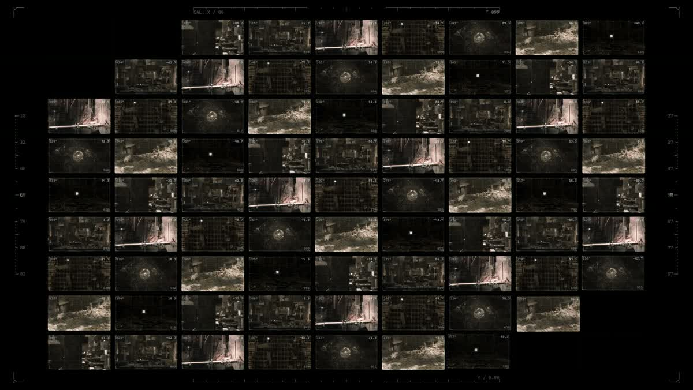
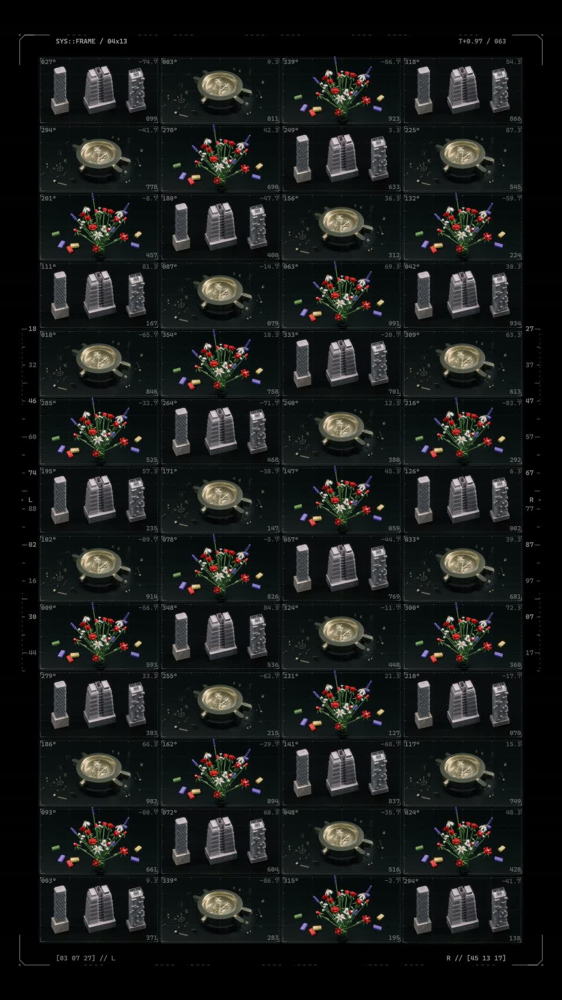

# 04 / Animated Storyboard

[Demo](https://muwentrili.github.io/creative-workflows/collage-motion/)

**Compare separate clips on one moving board, revise the shot selection and export a review composition.**

Tech stack: HTML, JavaScript, Canvas, browser video, WebCodecs and mp4-muxer. It arranges existing images and clips; it does not generate motion from still images or run an AI agent.

## Visual overview

[](https://muwentrili.github.io/creative-workflows/collage-motion/examples/review-board-demo.mp4)

**Finished output:** 35 selected moving shots, arranged 7 × 5 with the original white calibration graphics. [Play the eight-second film](https://muwentrili.github.io/creative-workflows/collage-motion/examples/review-board-demo.mp4) for the complete motion; the linked viewing copy is 1080p, while the checked original is 4K.

### The working editor


Input on the left, one board in the middle, composition and export controls on the right.

### Original clips and local corrections


The source collection sits below the canvas. Each card connects the displayed cell to its original viewing copy, order and inclusion state.

### Earlier visual design demonstrations

Two composition studies from the earlier visual direction. Each preview opens its film; these are separate from the current studio and checked export above.

<p align="center">
<a href="https://muwentrili.github.io/creative-workflows/collage-motion/process/landscape-design.mp4"></a>
<a href="https://muwentrili.github.io/creative-workflows/collage-motion/process/portrait-design.mp4"></a>
</p>

<p><em>Left to right:</em> <b>Landscape / wide review board</b> — A broad grid for comparing shots together.; <b>Portrait / vertical composition</b> — A taller arrangement for a different viewing format.</p>

The separate [earlier motion-controls recording](https://muwentrili.github.io/creative-workflows/collage-motion/process/motion-controls.mp4) documents the previous timing interface.

## Workflow and creator control

Load local media or the supplied 35-shot example. The app assigns stable source IDs, draws the visible shots in a grid and plays their motion together. The creator controls inclusion, order, crop, captions, layout, timing and the final review. Hiding a source preserves it for later use; removing a source is a separate action.

Separate files interrupt a production conversation: reviewers have to remember one shot while opening another. A parallel board keeps the images moving together and lets feedback refer to a stable shot identity. It is a shot-review composition, not a sequential edit with a sound mix.

The system lays out and plays the chosen media; it does not infer the story or replace shots autonomously. One source or crop can be changed without rebuilding the full board.

## Try one useful task

1. Start the Demo with the 35-shot board and pause playback.
2. Below the canvas, use **Source clips** to preview an original clip.
3. Hide one source, move another to a new position and check that its source ID stays the same. Restore the hidden source when needed.
4. Adjust a cell's framing or caption, replay, then use **Review & export**. Inspect the downloaded file as well as the canvas.

## Workflow diagram

<p align="center">

</p>

Codex assisted development. The runtime stages above use browser code; they do not call a generative AI model.

## Local setup

[Windows verification — October 28, 2026](../../docs/local-setup-check.md).

Requirements: **Git**, **Python 3.10+**, and desktop Chrome or Edge with Canvas and WebCodecs support. Node.js **22.13+** is optional for the focused regression check. No npm installation, build step, model or API key is required.

After installing Git and Python, check `git --version` and `python --version`. Then run:

```sh
git clone https://github.com/MuwenTriLi/creative-workflows.git
cd creative-workflows/docs/collage-motion
python -m http.server 8766 --bind 127.0.0.1
```

On Windows, use `py -3` instead of `python` if that is how Python is installed. Open **http://127.0.0.1:8766/** and stop the server with Ctrl+C. Use local HTTP; opening `index.html` as a file can block media/module loading. The example assets are bundled; external navigation needs internet. The source remains under `docs/collage-motion/` to preserve the published Demo URL.

In a second terminal, from the repository root:

```sh
node docs/collage-motion/tests/visibility.cjs
```

This checks inclusion, ordering and export-source filtering. For an actual output check, export a short board and review duration, motion and labels. The frozen [v0.1.0 demo release](https://github.com/MuwenTriLi/creative-workflows/releases/tag/animated-storyboard-v0.1.0) is another starting point; it is not automatically updated with the current source.

## Features and implementation

### Workspace and controls

The workspace shares Model Breakdown's restrained typography, rectangular controls and input–preview–inspector structure. A visitor sees the intended result before importing anything.

| Step | Try it | Creator decision |
| --- | --- | --- |
| **01 / Input** | Inspect the 35-shot example or use **Import media** | Choose the material and purpose of the review |
| **02 / Presentation** | Switch among six original white HUD styles or **Clean board** | Decide how much graphic context the footage needs |
| **03 / Local correction** | Select a cell, replace its source, change framing or adjust spacing | Revise the affected shot without rebuilding the board |
| **04 / Output** | **Review & export** → 4K → inspect the downloaded file | Accept framing, labels, motion and duration |

The original frame styles are Open data, Calibration, Code array, System index, Construction and Debug memory. Stable source IDs remain visible by default. `#001` identifies the current position; `S053` identifies the supplied shot. The examples do not invent shooting dates or spoken subtitles. Editable descriptions are available in the Assets controls; the chosen HUD determines which metadata is rendered.

### Why these controls exist

| Production problem | Implemented mechanism | Check before delivery |
| --- | --- | --- |
| Separate files interrupt comparison | One moving board with a curated opening example | The reviewer can identify and compare the intended shots |
| Dense presentation can hide the footage | Independent HUD presets, white graphic treatment and clean view | Labels and graphics do not cover the subject |
| Feedback is usually about one part | Selected-cell source replacement and framing controls | Other shots and their order remain intact |
| Many simultaneous decoders can freeze | The supplied 35-shot board uses one optimized video atlas; higher-resolution media is loaded for export | Every displayed cell actually moves, including in the encoded file |
| An encoder success message can conceal static output | Fixed-time export and decoded-frame checks | Duration, frame count and the contents of each tile match the preview |

The preview atlas is about 9.6 MB; the export atlas is about 52.7 MB. This optimization applies to the built-in example. Visitor clips use the regular local-media path and still need device-specific performance checks. A 4K board does not turn each small source tile into an individual 4K image.

### Source clips: inspect and revise the board

The source collection sits directly below the canvas. Preview an individual shot, select it for framing and caption edits, move it earlier or later, or enter an exact position. Uncheck **Included in board** to retain a source while excluding it from both preview and export; **Include all** restores it. Removing a card affects only this board. Bundled sources are optimized viewing copies; imported sources use the visitor's own local files.

The 35-shot example uses one shared video atlas for simultaneous board playback. Individual source playback opens on demand, so the source collection does not create another 35 live video decoders.

### Recovery, implementation and handoff

Import replaces the sample. Loading an example over personal work requests confirmation; original files stay unchanged. Rendering locks editing and waits for media readiness. Undo and persistent project saving are not implemented: reload clears edits. Output is silent and contains the board, not the surrounding editor.

| Responsibility | Source |
| --- | --- |
| Example atlas and media selection | [index.html](../../docs/collage-motion/index.html): `loadSampleAtlas`, `sourceForAsset` |
| Source inspection and order | Same file: `previewSource`, `moveSelectedAsset` |
| Inclusion and visible assignment | Same file: `visibleAssetIndices`, `assignmentFor` |
| Fixed-time export | Same file: `seekExportSources`, `exportStandardMp4` |
| Example sources and focused checks | [manifest.json](../../docs/collage-motion/examples/manifest.json), [visibility.cjs](../../docs/collage-motion/tests/visibility.cjs) |

The [implementation map](../../docs/animated-storyboard-handoff.md) connects these functions to the correction and export checks. The prototype still needs isolated project state, persistence, undo and a tested device budget. The demo and BITFLIP presentation footage have no additional reuse license.

## Evidence and next step

The recorded example export is **8 seconds, 3840 × 2160, 24 fps, 192 frames**, with motion in all 35 tiles. A hidden-source export also passed. [Fixture details and limits](docs/validation.md).

Next: ask an unfamiliar filmmaker to import five clips, make one meaningful local correction and export a review board without coaching. Record failed imports, hesitation and help needed. Check the intended shots, readable labels, motion in every tile and the encoded duration.

Expand when the board improves the review conversation; revise distracting labels or controls; narrow the task if the real need is a sound-synchronized edit. No measured productivity improvement is claimed.
