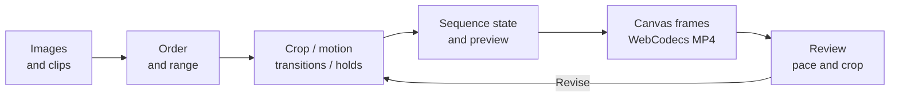

# 05 / Spatial Media Presenter

[Demo](https://flipframe-motion-lab.limuwen9.chatgpt.site)

**Turn an image and video collection into a spatial presentation with editable order, transitions and holds.**

Tech stack: React, TypeScript, browser media, Canvas, WebCodecs and mp4-muxer. The motion system evaluates a chosen sequence; it does not select a story for the creator.

## Workflow and creator control

Import media or use the 15-work example. The app evaluates the selected motion pattern and timing. The creator chooses content, editorial order, showcase range, crop, hold duration and graphic treatment, then reviews whether each work has enough reading time.

Muwen Li supplied the visual collection, motion direction, control hierarchy and iterative critique; Codex assisted implementation.

## Try one useful task

1. Pause the opening **Orbital Shift** example.
2. Select a media card and change its framing or hold time.
3. Replay the relevant transition and compare how long the work remains readable.
4. Export a short sequence using the direct MP4 path, then check the downloaded file's order, duration and crop.

## Workflow diagram



## Local setup

Requirements: Git, **Node.js 22.13+**, **pnpm 11.25.0**, and a desktop browser with Canvas/WebCodecs support. Use Chrome or Edge for comparison with the recorded checks. Install Git and Node.js first, then check `git --version` and `node --version`. Package downloads need internet. No API key or hosted account is needed by this local runner.

Run these commands in PowerShell, macOS Terminal or a Linux shell:

```sh
npm install --global pnpm@11.25.0
git clone https://github.com/MuwenTriLi/creative-workflows.git
cd creative-workflows/projects/05-spatial-media-presenter/source
pnpm install --frozen-lockfile --ignore-scripts
pnpm verify:source
pnpm dev --port 5173 --strictPort
```

Open **http://127.0.0.1:5173/**. Stop the server with Ctrl+C. If 5173 is occupied, stop the other server or choose another port. To check the production bundle:

```sh
pnpm test
pnpm build
pnpm preview --port 4173 --strictPort
```

Open **http://127.0.0.1:4173/** for the built app. Keep the tab in the foreground during export. Try a short FHD output before 4K; a successful build does not establish codec support or available GPU memory on another computer.

The supplied visual example is included. The snapshot matches hosted client version **50**. `pnpm test` checks sample migration and preservation of imported media; it is not an export-timing or usability test.

The [source manifest](source/source-manifest.json) records the hosted revision and hashes; `verify:source` checks the copied client files. The local Vite runner replaces the hosting wrapper. Public navigation links still open the hosted studios. [Source and media rights](source/RIGHTS.md) apply independently of these setup instructions.

## Features and implementation

- Media ordering, selected showcase ranges, per-card framing and timed holds.
- Spatial motion patterns, including the initial Orbital Shift example.
- Canvas rendering and direct MP4 output with an explicit sequence duration.

[page.tsx](source/app/page.tsx) owns archive and interface state; [exporter.ts](source/app/exporter.ts) evaluates timing and draws output frames. [sample-project.ts](source/app/sample-project.ts) handles sample upgrades. Stored backups exist, but the UI does not expose saved-board recovery. Long encodes may block interaction.

## Evidence and next step


Recorded direct **4K60** files matched **7.45 seconds / 447 frames** and **25 seconds / 1,500 frames**. The older compatibility-capture path did not meet its requested timing; do not infer that every export mode is validated. [Results and limitations](docs/validation.md).

Next: test longer mixed-media sequences and ask an unfamiliar viewer to assess reading time. Iterate pacing controls and responsiveness before expanding motion patterns. No viewer-readability or time-saving study is claimed.
