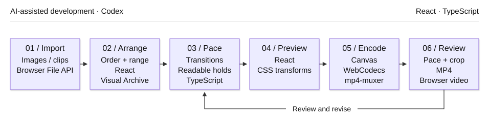

# 05 / Spatial Media Presenter

[Demo](https://flipframe-motion-lab.limuwen9.chatgpt.site)

**Turn an image and video collection into a spatial presentation with editable order, transitions and holds.**

Tech stack: React, TypeScript, browser media, Canvas, WebCodecs and mp4-muxer. The motion system evaluates a chosen sequence; it does not select a story for the creator.

## Visual overview

<p align="center"><a href="https://muwentrili.github.io/creative-workflows/collage-motion/process/flipframe-sequence.mp4"></a></p>

[Play the complete 25-second film](https://muwentrili.github.io/creative-workflows/collage-motion/process/flipframe-sequence.mp4) · [View a still frame](../../docs/collage-motion/process/flipframe-sequence.jpg)

The animation presents the complete 25-second sequence at its original speed, then repeats. Select it for the 1080p60 video with playback controls. This viewing copy comes from the recorded 4K60 / 1,500-frame export.

### Inside the editor

[](https://flipframe-motion-lab.limuwen9.chatgpt.site)

The opening collection contains 15 supplied works: 11 stills and 4 motion studies. It starts in Orbital Shift; pause, numbering, language and six white HUD treatments sit above the canvas.

## Workflow and creator control

Import media or use the 15-work example. The app evaluates the selected motion pattern and timing. The creator chooses content, editorial order, showcase range, crop, hold duration and graphic treatment, then reviews whether each work has enough reading time.

A sequence needs both impact and enough time to read each image. Reordering the source media or changing the pace of a spatial presentation can require adjusting many transitions, holds and camera-like moves. A visually impressive transition is not useful if viewers cannot understand the content it reveals.

Use one ordered **Visual Archive** as the sequence source, with a spatial preview and visible timing controls. Separate the fast introductory scan from the slower showcase range. Keep cards readable while the sequence moves through space, and make the transition between speed and pause adjustable.

## Try one useful task

**Task:** keep the editorial order fixed and give one important card a longer readable hold.

1. Open the English-default app. **Load portfolio example** brings back the 15-work collection; **Import media** on the left accepts your own images or clips.
2. Select a card in **Visual archive**, adjust its framing, and set the IN/OUT showcase range. Drag the archive to change the editorial order.
3. Try the six white **Frame & side HUD** buttons above the preview. Use **Show numbers** and the adjacent **中文 / EN** switch without searching through settings.
4. Use **Play / Pause** above the canvas, then scrub the timeline. Pause stops both the sequence and its source clips. Compare **Wave rail** and **Step showcase**, and adjust the hold or deceleration.
5. Open **Review & export** on the right. Check the sequence order, reading time, framing and selected overlays before exporting.

**Starting state and recovery:** the supplied 15-asset collection starts its Orbital Shift sequence automatically. The toolbar pauses it; the full-animation control replays it. There is no Resume saved board prompt. Imported work is retained locally as a backup when switching to the example, but no recovery interface is currently exposed; export your work before leaving.

Make one framing or hold correction, replay the affected transition, then inspect the complete encoded sequence. Protected-card locks and revision rollback are not implemented guarantees.

## Workflow diagram

<p align="center">

</p>

Codex assisted development. The runtime stages above use browser code; they do not call a generative AI model.

## Local setup

[Windows verification — October 28, 2026](../../docs/local-setup-check.md).

Requirements: Git, **Node.js 22.13+**, **pnpm 11.25.0**, and a desktop browser with Canvas/WebCodecs support. Use Chrome or Edge for comparison with the recorded checks. Install Git and Node.js first, then check `git --version` and `node --version`. Package downloads need internet. No API key or hosted account is needed by this local runner.

Windows can run this directly in PowerShell; Windows Subsystem for Linux (WSL) and Cursor are optional. The same commands also work in macOS Terminal or a Linux shell:

```sh
npm install --global pnpm@11.25.0
git clone https://github.com/MuwenTriLi/creative-workflows.git
cd creative-workflows/projects/05-spatial-media-presenter/source
pnpm install --frozen-lockfile --ignore-scripts
pnpm verify:source
pnpm dev --port 5173 --strictPort
```

Open **http://127.0.0.1:5173/**. Stop the server with Ctrl+C. If 5173 is occupied, stop the other server or choose another port. To check the production bundle:

```sh
pnpm test
pnpm build
pnpm preview --port 4173 --strictPort
```

Open **http://127.0.0.1:4173/** for the built app. Keep the tab in the foreground during export. Try a short FHD output before 4K; a successful build does not establish codec support or available GPU memory on another computer.

The supplied visual example is included. The snapshot matches hosted client version **50**. `pnpm test` checks sample migration and preservation of imported media; it is not an export-timing or usability test.

The [source manifest](source/source-manifest.json) records the hosted revision and hashes; `verify:source` checks the copied client files. The local Vite runner replaces the hosting wrapper. Public navigation links still open the hosted studios. [Source and media rights](source/RIGHTS.md) apply independently of these setup instructions.

## Features and implementation

### Controls and their purpose

| Creative decision | Visible control | Purpose |
| --- | --- | --- |
| Which stories appear, and in what order? | Drag-to-reorder archive; IN/OUT showcase range | Connect content order to presentation order |
| How does the sequence move? | Wave rail, step showcase and rapid lock modes | Compare different presentation rhythms |
| When does the motion settle? | Peak speed, deceleration duration and curve strength | Shape the transition from overview to detail |
| How long can viewers inspect an image? | Per-card transition and hold duration | Give each item readable screen time |
| How should each source fit? | Clip trim, size and position; 16:9 / 9:16 canvas | Adapt mixed media to the presentation |
| Which information should surround the work? | Six frame-and-side-HUD presets; Show numbers; detailed overlay controls | Review the same framing and shot identifiers in the preview and output |

### Source responsibilities

| Responsibility | Source |
| --- | --- |
| Archive, import, framing and playback | [page.tsx](source/app/page.tsx) |
| Sequence timing and output frames | [exporter.ts](source/app/exporter.ts): `stepSequenceDuration`, `stepSequenceState`, `hookShowcaseState`, `rollMotionOffset` |
| Example migration without discarding imported media | [sample-project.ts](source/app/sample-project.ts): `needsSampleUpgrade` |

The preview and encoder must evaluate the same order, transitions and holds. Stored backups exist, but the current UI does not expose saved-board recovery. Long encoding can block interaction. A future handoff should isolate timeline evaluation from media loading before expanding motion modes.

The reusable unit is an editable presentation sequence. An automatic timing proposal, semantic content locks, revision comparison and readability judgments would be future features, not behavior demonstrated by this app.

## Evidence and next step

Recorded direct **4K60** files matched **7.45 seconds / 447 frames** and **25 seconds / 1,500 frames**. The older compatibility-capture path did not meet its requested timing; do not infer that every export mode is validated. [Results and limitations](docs/validation.md).

For delivery, check that the intended cards appear in order, subjects stay framed, key work has readable screen time and transitions do not jump or hide the content. Encoding success alone does not establish those qualities.

Next: compare the same media at two hold settings and ask unfamiliar viewers which works they can identify. Record the creator's correction steps. Expand a timing preset only if readability and editability both hold; revise rushed cards or disorienting transitions. No viewer-readability or time-saving study is claimed.
