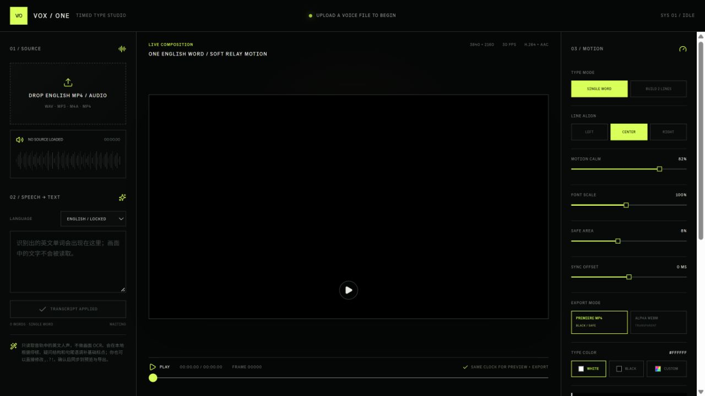

# VOX / ONE / Speech to Motion Type

[← All projects](https://github.com/MuwenTriLi/creative-workflows#selected-work)

**06 / Browser tool · Speech timing & kinetic typography**

Turn spoken English into editable, timed typography, with control over phrasing, visual emphasis and synchronization.

**[Open web app ↗](https://vox-one.limuwen9.chatgpt.site)** · No sign-in required

*Current editor before audio import. A paired audio-and-type example is pending.*

## The smallest useful task

**Task:** use a short authorized English clip containing a proper noun, a pause and a phrase boundary. Correct its transcript, create one readable treatment and verify the encoded result against the audio. This processing test is pending.

**Local correction:** the interface offers editable text and sync offset. Correct a misspelled word without rewriting the speaker's meaning; use a global offset only for uniform drift. Whether one word can be retimed without disturbing neighboring words must be tested. Region-level reprocessing and retained revisions are proposed requirements.

**Decision now:** validate recognition, correction and synchronized export before adding languages or agent features. Expand only when wording and timing can be corrected reliably. Iterate local timing recovery; stop a phrasing rule that changes meaning. No recognition-accuracy or time-saving result is claimed.

## The problem

Speech-led motion graphics require more than a transcript. Words need readable grouping, accurate timing and a visual rhythm that follows the speaker. A text correction can affect both the layout and timing; treating transcription, typography and animation as disconnected steps makes iteration harder.

## The approach

Connect the source audio, editable transcript, word timeline and composition in one workspace. Let creators switch between single-word emphasis and a two-line phrase layout, then tune motion intensity, type scale, safe area and synchronization without changing tools.

| Creative decision | Visible control | Purpose |
| --- | --- | --- |
| What was actually said? | Editable transcript and punctuation | Keep human correction in the workflow |
| How should viewers read it? | Single word / Build 2 lines | Compare emphasis with phrase readability |
| How should type feel? | Motion calm, font scale, alignment and color | Tune expression without obscuring speech |
| Does it follow the voice? | Timeline and sync offset | Inspect and adjust audio/type alignment |
| How will it be composited? | Black-background MP4 / transparent WebM options | Prepare output for different editing workflows |

## Walkthrough

1. Bring a short English voice clip in a format listed by the app: WAV, MP3, M4A or MP4.
2. Review the transcript and correct words or punctuation before refining the visual treatment.
3. Compare **Single word** with **Build 2 lines**. Adjust alignment, scale and motion calm.
4. Preview against the audio and check phrase boundaries and sync offset.
5. Choose the output style that fits the destination editor; check the resulting file before using it in a production edit.

## Design contribution and reusable workflow

The design focus is the correction loop between speech and presentation: automatic timing is useful only when the creator can revise its wording, phrasing and visual emphasis. The reusable unit is a typography treatment applied to a new voice clip. Video output makes this a creative application; it does not by itself make the project an installable agent Skill.

## Automation, creator control and delivery

**Hypothesis:** connecting transcript correction, phrase layout and timing reduces the cost of revising speech-led motion graphics. This has not yet been established by comparative testing.

**Current behavior:** the interface describes automatic local transcription and word timing, followed by editable text and visual controls. This review did not run the recognizer. The creator owns wording, punctuation, phrase meaning, emphasis and final sync.

**Proposed agent behavior:** generate a first transcript and layout, make doubtful spans easy to inspect against the audio, and apply approved style settings. An agent should request review before rewriting meaning, removing words or substituting names. A confidence display, semantic approval and revision history are proposed requirements, not verified current UI.

**Acceptance:** names and wording match the source; grouping preserves meaning; text stays inside the safe area and remains readable; the full encoded output is checked against audio for synchronization. Define the acceptable sync tolerance for the intended use before the test. A plausible transcript or attractive screenshot is insufficient evidence.

**Next test / decision:** use a short authorized clip with a proper noun, a pause and a phrase boundary. Record recognition errors, correction time, sync adjustment and exported playback. Expand only when these are correctable and the output passes; iterate if corrections are awkward; stop an automatic phrasing rule when it changes meaning. [Control model and handoff](../docs/creative-control.md).

## Evidence and current limits

The public interface is accessible and its controls are documented here. It identifies the speech engine as **local Whisper Base with word timestamps**; that is the implementation described by the interface, not a new transcription benchmark. This portfolio update did not run speech recognition or verify the advertised 4K MP4/AAC and alpha WebM exports. The current interface is focused on English speech, not visual OCR.

## Case evidence to add

A short authorized voice sample, the corrected transcript, and two typography treatments using the same audio. Include one real correction and its effect on the final sequence, with Muwen's specific role and implementation details.
