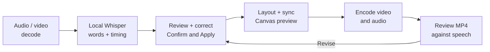

# 06 / Kinetic Typography Studio

[Demo](https://vox-one.limuwen9.chatgpt.site)

**Turn spoken English into timed typography that the creator can correct, arrange and export.**

Tech stack: React, TypeScript, Transformers.js, quantized Whisper Base on browser WASM, Canvas and Mediabunny. Recognition uses an existing model; this project does not train a speech model.

## Workflow and creator control

Import speech, let local Whisper propose words and timestamps, then review the transcript against the audio. The creator corrects words and punctuation, applies changes, chooses grouping and emphasis, adjusts synchronization and accepts the output. The opening silent sample uses authored text; it is not a transcription demonstration.

Muwen Li defined the speech-to-type interaction, correction loop, visual direction and acceptance criteria; Codex assisted implementation.

## Try one useful task

1. Explore the silent typography example without downloading a model.
2. Import a short English audio or video clip you are authorized to use. Start transcription and wait for the first model download and recognition.
3. Correct a word or punctuation in the transcript, then use **Confirm & Apply**.
4. Compare the type layouts and sync against the original audio. Export MP4 and play the result through with sound.

## Workflow diagram



## Local setup

Requirements: Git, **Node.js 22.13+**, **pnpm 11.25.0**, and a desktop browser with Canvas/WebCodecs support. Use Chrome or Edge for comparison with the recorded checks. Install Git and Node.js first, then check `git --version` and `node --version`. Package downloads need internet. No API key or hosted account is needed by this local runner.

Run these commands in PowerShell, macOS Terminal or a Linux shell:

```sh
npm install --global pnpm@11.25.0
git clone https://github.com/MuwenTriLi/creative-workflows.git
cd creative-workflows/projects/06-kinetic-typography/source
pnpm install --frozen-lockfile --ignore-scripts
pnpm verify:source
pnpm dev --port 5173 --strictPort
```

Open **http://127.0.0.1:5173/**. Stop the server with Ctrl+C. If 5173 is occupied, stop the other server or choose another port. To check the production bundle:

```sh
pnpm build
pnpm preview --port 4173 --strictPort
```

Open **http://127.0.0.1:4173/** for the built app. Keep the tab in the foreground during export. Try a short FHD output before 4K; a successful build does not establish codec support or available GPU memory on another computer.

The snapshot matches hosted client version **22**. First transcription downloads `onnx-community/whisper-base_timestamped` (q8) and WASM runtime resources; browser caching is enabled. Inference then runs in the browser. The silent demo does not fetch the speech model. Initial transcription is not an offline workflow, and model download failure must be resolved before testing recognition. No paid inference endpoint is configured.

The [source manifest](source/source-manifest.json) records the hosted revision and hashes; `verify:source` checks the copied client files. The local Vite runner replaces the hosting wrapper. Public navigation links still open the hosted studios. [Source and media rights](source/RIGHTS.md) apply independently of these setup instructions.

## Features and implementation

- English speech recognition with editable word timing and transcript correction.
- Single-word or grouped type, style controls and synchronization offset.
- MP4 with audio; a transparent WebM option is present but remains outside the recorded delivery acceptance.

[page.tsx](source/app/page.tsx) includes `beginTranscription`, `chunksToWords`, `alignEditedWords`, Canvas rendering and export. The output is animated typography with speech audio; the current workflow does not claim to composite the original video as a background layer. A future handoff should isolate recognition, transcript state and rendering.

## Evidence and next step


A clean **16-word synthetic English fixture**, punctuation correction and **4K H.264/AAC export** passed the recorded checks. This establishes a bounded speech-to-output path, not recognition accuracy on real production recordings. [Test details](docs/validation.md).

Next: record real names, noise and accents, measure correction effort and perceptual sync, and validate transparent output separately. Do not generalize the synthetic fixture into a recognition or usability benchmark.
