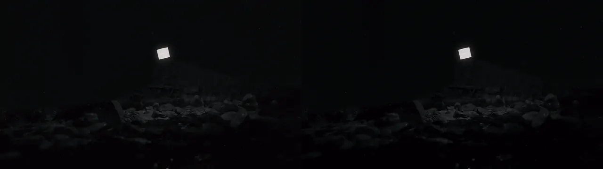
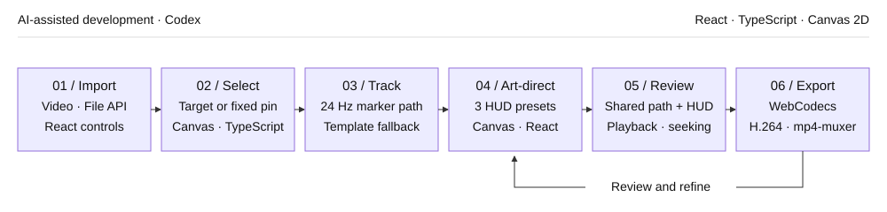

# 06 / Motion Tracking Studio

[Demo](https://muwentrili.github.io/creative-workflows/motion-tracking/)

**Select a video target, art-direct its heads-up display (HUD), and export the same composition you review in the browser.**

Tech stack: React, TypeScript, Canvas template/bright-marker tracking, WebCodecs and mp4-muxer. Tracking estimates visual similarity; it does not recognize semantic object identity.

## Visual overview

Seven supplied shots pair the original footage with its tracked HUD. **One shared video frame keeps both sides synchronized**, including autoplay, seeking and looping.

<p align="center">
<a href="https://muwentrili.github.io/creative-workflows/motion-tracking/compare/"></a>
</p>

**Left:** Source footage · **Right:** Actual app export. Seven shots · 30.75 s · three HUD presets. [Play the full-quality synchronized demo](https://muwentrili.github.io/creative-workflows/motion-tracking/compare/).

The studio opens with the same muted, looping comparison. Choose **Edit footage**, load a shot and use **Use demo target** to reproduce its selection and preset; then change the styling, timing or target. [Reproduction settings and measured outputs](docs/hud-studio-demo.md).

## Workflow and creator control

A moving annotation needs both a reliable attachment and a readable graphic. This workspace brings target selection, motion review and HUD styling into one loop: choose what to follow, choose a visual language, then tune emphasis without moving to another application.

**Signal Lock** uses a quiet corner locator; **Vector Scope** uses a circular reticle and coordinate scope; **Data Grid** uses technical brackets and an editable readout. Type, color, scale, offset and entrance timing remain adjustable. Subtle peripheral numbers display media time and measured position; their intensity can be reduced or switched off.

An explicitly selected bright marker is analyzed once at 24 samples/s. Playback, timeline seeking and export reuse that trajectory and the same Canvas HUD renderer. Other selections use template matching; **Position anchor** provides an explicit fixed annotation. Tracking confidence is a diagnostic, not an accuracy score.

## Try one useful task

1. Load any of the seven **Example footage** clips. Choose **Use demo target** to recreate the demonstrated setup, or click your own target in a clear frame.
2. Pick **Signal Lock**, **Vector Scope** or **Data Grid** in the right-hand library. Refine the title, copy, color, locator/panel scale and peripheral detail intensity.
3. Scrub and play the same prepared trajectory. Adjust **LOCK IN** and **HUD IN** separately to stage the locator before the expanded panel.
4. Export at **24, 30 or 60 fps**, review the actual MP4, then download it. The supplied clips and demo use **4K / 24 fps**; audio is optional and off by default.

Try one difficult interval as well as an easy shot. If the path moves onto the wrong subject, inspect target selection and search behavior instead of using smoothing to hide it. A fixed annotation is a different, explicit creative choice. Frame-level path edits, locked good segments and regional retracking are not established recovery features.

## Workflow diagram

<p align="center">

</p>

Codex assisted development. The runtime stages above use browser code; they do not call a generative AI model.

## Local setup

[Windows verification — October 28, 2026](../../docs/local-setup-check.md).

Requirements: Git, **Node.js 22.13+**, **pnpm 11.25.0**, and a desktop browser with Canvas/WebCodecs support. Use Chrome or Edge for comparison with the recorded checks. Install Git and Node.js first, then check `git --version` and `node --version`. Package downloads need internet. No API key or hosted account is needed by this local runner.

Windows can run this directly in PowerShell; Windows Subsystem for Linux (WSL) and Cursor are optional. The same commands also work in macOS Terminal or a Linux shell:

```sh
npm install --global pnpm@11.25.0
git clone https://github.com/MuwenTriLi/creative-workflows.git
cd creative-workflows/projects/06-motion-tracking/source
pnpm install --frozen-lockfile --ignore-scripts
pnpm verify:source
pnpm dev --port 5173 --strictPort
```

Open **http://127.0.0.1:5173/**. Stop the server with Ctrl+C. If 5173 is occupied, stop the other server or choose another port. To check the production bundle:

```sh
pnpm test
pnpm build
pnpm preview --port 4173 --strictPort
```

Open **http://127.0.0.1:4173/** for the built app. Keep the tab in the foreground during export. Try a short FHD output before 4K; a successful build does not establish codec support or available GPU memory on another computer.

This revision extends the version **19** client with seven example clips, three editable HUD presets, a shared prepared trajectory and an autoplay comparison. Entering the editor requires an explicit clip and target choice. `pnpm test` checks marker tracking, cached-path replay and deterministic export timing; it is not a general accuracy benchmark. AAC audio encoding requires browser support.

In local development, successful exports are also saved to the ignored `.local-exports/` folder for inspection. This loopback-only Vite helper is absent from the production build; the published studio offers the normal browser download.

The [source manifest](source/source-manifest.json) records the original hosted revision, current changes and hashes; `verify:source` checks this documented revision. The local Vite runner replaces the hosting wrapper. Navigation links open the current public studios. [Source and media rights](source/RIGHTS.md) apply independently of these setup instructions.

## Features and implementation

### Controls and their purpose

| Creative decision | Visible control | Purpose |
| --- | --- | --- |
| Follow a subject or mark a place? | Track a target / Position anchor | Match the overlay's behavior to the explanation |
| How should the path behave? | Prepared bright-marker trajectory; template search radius / smoothing | Review the selected subject over time |
| When should information appear? | LOCK IN and HUD IN timeline markers | Stage attention before adding detail |
| How much visual emphasis is needed? | Locator size, panel size and entrance mode | Keep the source footage legible |
| What information belongs in the graphic? | Title, text fields, color and HUD presets | Adapt the annotation to the scene |

The tracker exposes confidence and a REACQUIRE state. A live confidence value is not a ground-truth accuracy measure or proof of recovery. A reviewable confidence history, editable correction path and retained revisions remain future work.

### Frame-based output and source responsibilities

| Responsibility | Source |
| --- | --- |
| Target/anchor selection, tracking and Canvas overlays | [page.tsx](source/app/page.tsx) |
| Bounded bright-marker detection and loss handling | [bright-marker.mjs](source/app/bright-marker.mjs) |
| Shared prepared trajectory and replay | [marker-path.mjs](source/app/marker-path.mjs) |
| Three presets and peripheral telemetry | [peripheral-hud.ts](source/app/peripheral-hud.ts) |
| Deterministic frame counts and timestamps | [export-timing.mjs](source/app/export-timing.mjs) |
| Seek the source, encode H.264, mux MP4 and optional AAC | [export-mp4.mjs](source/app/export-mp4.mjs) |

Sequential frame encoding replaces the earlier real-time recording path. It includes cancellation and encoder backpressure; editing is locked during export. Unsupported encoding is reported instead of silently substituting a timing-incorrect output. Source audio is optional and off by default.

## Evidence and next step

The seven supplied clips were exported through the actual browser application at **3840 × 2160 / 24 fps**. Their sequence contains **738 frames / 30.75 seconds**. The synchronized comparison contains both views in one **3840 × 1080** frame; its README preview is an automatically looping WebP. [Settings, hashes and inspection record](docs/hud-studio-demo.md).

The [earlier three-shot revision](docs/white-marker-demo.md) and [synthetic timing fixtures](docs/export-check.md) remain as historical checks, including optional audio. They are separate from the current visual demo.

This is a bounded white-marker workflow. General object identity through occlusion, regional path correction and unfamiliar-creator usability remain unverified. Next: annotate harder sequences and measure wrong-target intervals and correction effort.
