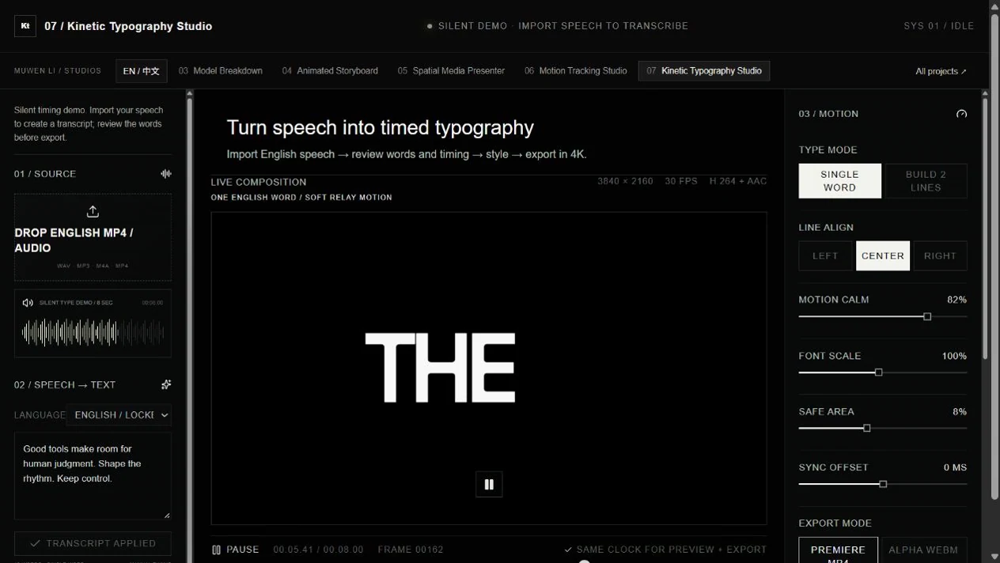
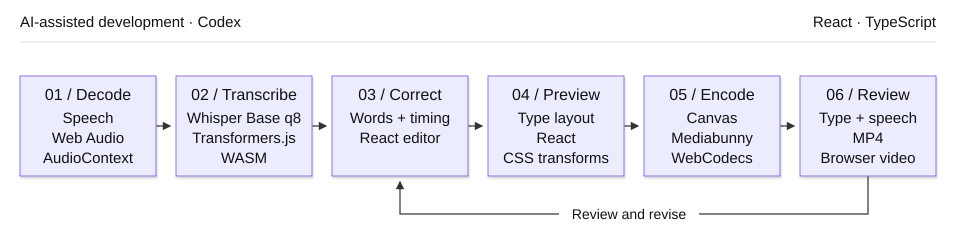

# 07 / Kinetic Typography Studio

[Demo](https://muwentrili.github.io/creative-workflows/kinetic-typography/)

**Turn spoken English into timed typography that the creator can correct, arrange and export.**

Tech stack: React, TypeScript, Transformers.js, quantized Whisper Base on browser WASM, Canvas and Mediabunny. Recognition uses an existing model; this project does not train a speech model.

## Visual overview

<p align="center"><a href="https://muwentrili.github.io/creative-workflows/kinetic-typography/"></a></p>

The preview records eight seconds of the live interface at its original playback speed, preserving both side panels and the central composition. The text and timing are authored silent demo data. Importing a voice clip exercises the separate speech-recognition path.

The left panel contains source and transcript; the center shows the typography; the right panel controls grouping, alignment, motion, size and sync. The Demo runs the live composition.

## Workflow and creator control

Import speech, let local Whisper propose words and timestamps, then review the transcript against the audio. The creator corrects words and punctuation, applies changes, chooses grouping and emphasis, adjusts synchronization and accepts the output. The opening silent sample uses authored text; it is not a transcription demonstration.

Speech-led motion graphics require more than a transcript. Words need readable grouping, accurate timing and a visual rhythm that follows the speaker. A text correction can affect both the layout and timing; treating transcription, typography and animation as disconnected steps makes iteration harder.

Connect the source audio, editable transcript, word timeline and composition in one workspace. Let creators switch between single-word emphasis and a two-line phrase layout, then tune motion intensity, type scale, safe area and synchronization without changing tools.

## Try one useful task

1. Explore the silent typography example without downloading a model.
2. Import a short English audio or video clip you are authorized to use. Start transcription and wait for the first model download and recognition.
3. Correct a word or punctuation in the transcript, then use **Confirm & Apply**.
4. Compare the type layouts and sync against the original audio. Export MP4 and play the result through with sound.

Use a clip containing a proper noun, a pause and a phrase boundary. Keep the speaker's meaning intact when correcting the text; use a global sync offset only for uniform drift. An isolated word-timing correction without disturbing its neighbors still needs verification. Retained revisions and region-level reprocessing are not established features.

## Workflow diagram

<p align="center">

</p>

Speech model: `onnx-community/whisper-base_timestamped`, q8, running locally through Transformers.js on WebAssembly (WASM). Codex assisted development; it is separate from runtime speech recognition.

## Local setup

[Windows verification — October 28, 2026](../../docs/local-setup-check.md).

Requirements: Git, **Node.js 22.13+**, **pnpm 11.25.0**, and a desktop browser with Canvas/WebCodecs support. Use Chrome or Edge for comparison with the recorded checks. Install Git and Node.js first, then check `git --version` and `node --version`. Package downloads need internet. No API key or hosted account is needed by this local runner.

Windows can run this directly in PowerShell; Windows Subsystem for Linux (WSL) and Cursor are optional. The same commands also work in macOS Terminal or a Linux shell:

```sh
npm install --global pnpm@11.25.0
git clone https://github.com/MuwenTriLi/creative-workflows.git
cd creative-workflows/projects/07-kinetic-typography/source
pnpm install --frozen-lockfile --ignore-scripts
pnpm verify:source
pnpm dev --port 5173 --strictPort
```

Open **http://127.0.0.1:5173/**. Stop the server with Ctrl+C. If 5173 is occupied, stop the other server or choose another port. To check the production bundle:

```sh
pnpm build
pnpm preview --port 4173 --strictPort
```

Open **http://127.0.0.1:4173/** for the built app. Keep the tab in the foreground during export. Try a short FHD output before 4K; a successful build does not establish codec support or available GPU memory on another computer.

The snapshot matches hosted client version **22**. First transcription downloads `onnx-community/whisper-base_timestamped` (q8) and WASM runtime resources; browser caching is enabled. Inference then runs in the browser. The silent demo does not fetch the speech model. Initial transcription is not an offline workflow, and model download failure must be resolved before testing recognition. No paid inference endpoint is configured.

The [source manifest](source/source-manifest.json) records the hosted revision and hashes; `verify:source` checks the copied client files. The local Vite runner replaces the hosting wrapper. Public navigation links still open the hosted studios. [Source and media rights](source/RIGHTS.md) apply independently of these setup instructions.

## Features and implementation

### Controls and their purpose

| Creative decision | Visible control | Purpose |
| --- | --- | --- |
| What was actually said? | Editable transcript and punctuation | Keep human correction in the workflow |
| How should viewers read it? | Single word / Build 2 lines | Compare emphasis with phrase readability |
| How should type feel? | Motion calm, font scale, alignment and color | Tune expression without obscuring speech |
| Does it follow the voice? | Timeline and sync offset | Inspect and adjust audio/type alignment |
| How will it be composited? | Black-background MP4 / transparent WebM options | Prepare output for different editing workflows |

The transparent WebM option exists but is outside the recorded delivery acceptance. The checked path is black-background MP4 with speech audio. The current output does not composite the original source video as a background layer.

### Recognition, correction and rendering

| Stage | Source responsibility |
| --- | --- |
| Start local inference | `beginTranscription` in [page.tsx](source/app/page.tsx) |
| Convert recognition chunks to timed words | `chunksToWords` |
| Apply edited text to the word sequence | `alignEditedWords`, followed by the creator's **Confirm & Apply** action |
| Compose and deliver | Canvas typography and Mediabunny encoding in the same client |

The creator owns wording, punctuation, phrase meaning, emphasis and final sync. Confidence-span review, semantic approval and revision history are future requirements, not current UI claims. Recognition, transcript state and rendering should be isolated further for engineering handoff.

## Evidence and next step

A clean **16-word synthetic English fixture**, punctuation correction and **4K H.264/AAC export** passed the recorded checks. This establishes a bounded speech-to-output path, not recognition accuracy on real production recordings. [Test details](docs/validation.md).

The clean 7.55-second fixture produced the expected 16 words. A punctuation-only correction retained the displayed word times. The 4K H.264 / 30 fps / 227-frame output with AAC audio fully decoded. This is not a recognition benchmark.

For a real delivery, verify names and wording against the source, preserve phrase meaning, keep text in the safe area and play the entire encoded output with audio. Define the acceptable sync tolerance for that use before the test.

Next: record authorized speech with real names, noise and accents; measure correction effort and perceptual sync; validate transparent output and an editing-application round trip separately. Expand only when wording and timing are correctable. No real-speech accuracy or time-saving result is claimed.
