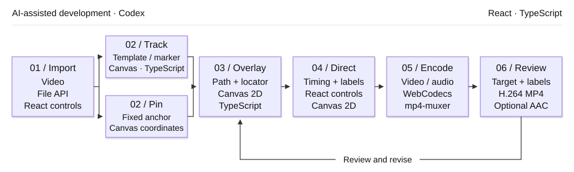

# 07 / Motion Tracking Studio

[Demo](https://muwentrili.github.io/creative-workflows/motion-tracking/)

**Attach a locator and information overlay to a chosen video target or a fixed position.**

Tech stack: React, TypeScript, Canvas template/bright-marker tracking, WebCodecs and mp4-muxer. Tracking estimates visual similarity; it does not recognize semantic object identity.

## Visual overview

Two matched videos show the same three shots: **Cube leaps → Ravine flight → Buried machine**. On the right, the selected white marker drives the target locator and a staged heads-up display (HUD).

<table>
<tr><th>Source footage</th><th>Tracked target + HUD</th></tr>
<tr>
<td width="50%"><video controls src="https://github.com/user-attachments/assets/e048ccfb-3f88-46ab-8a59-a9ebea358775" width="100%"></video><p>Three supplied clips · 14 s</p></td>
<td width="50%"><video controls src="https://github.com/user-attachments/assets/d91151ff-a6e8-4880-9586-0a1da6155197" width="100%"></video><p>Actual app export · 14 s</p></td>
</tr>
</table>

Silent 1080p previews retain the source's 24 fps cadence. The live Demo includes all three clips: load one, click its white marker and press Play. [4K delivery and check record](docs/white-marker-demo.md).

## Workflow and creator control

Import footage and explicitly choose a target or place a fixed anchor. A selected bright neutral marker uses a bounded component search; other subjects use template matching. The interface reports confidence and reacquisition state. The creator decides which subject matters, whether to track or pin it, how to label it and when the locator and information panel appear. Smoothing cannot repair a target switch.

A motion annotation has two separate requirements: stay attached to the correct subject and remain readable. Tracking may drift, while labels can arrive too early, cover the subject or distract from it. Treating the tracker and graphic styling as separate tasks makes those problems harder to inspect together.

Bring source video, frame navigation, target positioning and HUD design into one workspace. Expose **Track a target** and **Position anchor** as distinct choices. Separate the locator's entrance from the expanded data panel so the viewer first sees the target, then reads its context.

## Try one useful task

1. Load **Cube leaps**, **Ravine flight** or **Buried machine** from Example footage, or import your own clip. Pause on a clear frame.
2. Choose **Track a target** and select the subject, or choose **Position anchor** for a fixed locator.
3. Play the clip and inspect the path. Adjust **LOCK IN** and **HUD IN** timing separately.
4. Export a short MP4, review it in the export panel, then choose **Download MP4**. Source audio is optional and off by default. Check subject identity, overlay readability and duration.

Try one difficult interval as well as an easy shot. If the path moves onto the wrong subject, inspect target selection and search behavior instead of using smoothing to hide it. A fixed annotation is a different, explicit creative choice. Frame-level path edits, locked good segments and regional retracking are not established recovery features.

## Workflow diagram

<p align="center">

</p>

Codex assisted development. The runtime stages above use browser code; they do not call a generative AI model.

## Local setup

[Windows verification — October 28, 2026](../../docs/local-setup-check.md).

Requirements: Git, **Node.js 22.13+**, **pnpm 11.25.0**, and a desktop browser with Canvas/WebCodecs support. Use Chrome or Edge for comparison with the recorded checks. Install Git and Node.js first, then check `git --version` and `node --version`. Package downloads need internet. No API key or hosted account is needed by this local runner.

Windows can run this directly in PowerShell; Windows Subsystem for Linux (WSL) and Cursor are optional. The same commands also work in macOS Terminal or a Linux shell:

```sh
npm install --global pnpm@11.25.0
git clone https://github.com/MuwenTriLi/creative-workflows.git
cd creative-workflows/projects/07-motion-tracking/source
pnpm install --frozen-lockfile --ignore-scripts
pnpm verify:source
pnpm dev --port 5173 --strictPort
```

Open **http://127.0.0.1:5173/**. Stop the server with Ctrl+C. If 5173 is occupied, stop the other server or choose another port. To check the production bundle:

```sh
pnpm test
pnpm build
pnpm preview --port 4173 --strictPort
```

Open **http://127.0.0.1:4173/** for the built app. Keep the tab in the foreground during export. Try a short FHD output before 4K; a successful build does not establish codec support or available GPU memory on another computer.

This revision extends the version **19** client with bright-marker tracking, three explicit example choices and an export-review player. No clip or target is selected automatically. `pnpm test` checks marker selection, movement, loss and skipped callbacks, plus deterministic export timing; it is not a general accuracy benchmark. AAC audio encoding requires browser support.

The [source manifest](source/source-manifest.json) records the original hosted revision, current changes and hashes; `verify:source` checks this documented revision. The local Vite runner replaces the hosting wrapper. Public navigation links still open the hosted studios. [Source and media rights](source/RIGHTS.md) apply independently of these setup instructions.

## Features and implementation

### Controls and their purpose

| Creative decision | Visible control | Purpose |
| --- | --- | --- |
| Follow a subject or mark a place? | Track a target / Position anchor | Match the overlay's behavior to the explanation |
| How should the path behave? | Template search radius / smoothing; adaptive bright-marker mode | Match search behavior to the selected subject |
| When should information appear? | LOCK IN and HUD IN timeline markers | Stage attention before adding detail |
| How much visual emphasis is needed? | Locator size, panel size and entrance mode | Keep the source footage legible |
| What information belongs in the graphic? | Title, text fields, color and HUD presets | Adapt the annotation to the scene |

The tracker exposes confidence and a REACQUIRE state. A live confidence value is not a ground-truth accuracy measure or proof of recovery. A reviewable confidence history, editable correction path and retained revisions remain future work.

### Frame-based output and source responsibilities

| Responsibility | Source |
| --- | --- |
| Target/anchor selection, tracking and Canvas overlays | [page.tsx](source/app/page.tsx) |
| Bounded bright-marker detection and loss handling | [bright-marker.mjs](source/app/bright-marker.mjs) |
| Deterministic frame counts and timestamps | [export-timing.mjs](source/app/export-timing.mjs) |
| Seek the source, encode H.264, mux MP4 and optional AAC | [export-mp4.mjs](source/app/export-mp4.mjs) |

Sequential frame encoding replaces the earlier real-time recording path. It includes cancellation and encoder backpressure; editing is locked during export. Unsupported encoding is reported instead of silently substituting a timing-incorrect output. Source audio is optional and off by default.

## Evidence and next step

The three supplied shots produced actual browser exports at **3840 × 2160, 60 fps**: 270, 270 and 300 frames, with durations of **4.5, 4.5 and 5 seconds**. The two web previews each contain **336 frames / 14 seconds / 24 fps**. Source footage is 24 fps; a 60 fps export container does not create extra source-motion detail. [Inputs, settings, checks and 4K result](docs/white-marker-demo.md).

The original four-second synthetic fixtures remain in the [export timing record](docs/export-check.md), including the optional-audio test. They are separate technical fixtures rather than the main visual demo.

This establishes a bounded bright-marker example across the three supplied shots. General object identity through occlusion, regional correction and unfamiliar creator usability remain unverified. Next: annotate a harder sequence and record wrong-target intervals and correction effort before expanding the supported tracking scope.
