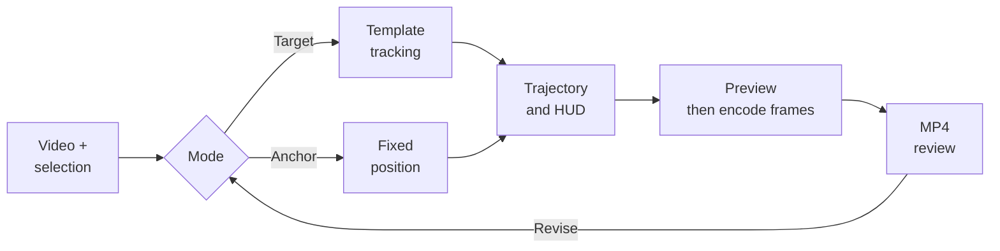

# 07 / Motion Tracking Studio

[Demo](https://trace-01-motion-tracker.limuwen9.chatgpt.site)

**Attach a locator and information overlay to a chosen video target or a fixed position.**

Tech stack: React, TypeScript, Canvas template matching, WebCodecs and mp4-muxer. Tracking estimates visual similarity; it does not recognize semantic object identity.

## Workflow and creator control

Import footage and explicitly choose a target or place a fixed anchor. The tracker searches for the selected template and reports confidence/reacquisition state. The creator decides which subject matters, whether to track or pin it, how to label it and when the locator and information panel appear. Smoothing cannot repair a target switch.

Muwen Li defined the target/anchor workflow, staged visual hierarchy and review criteria; Codex assisted implementation.

## Try one useful task

1. Import a short, high-contrast video and pause on a clear frame.
2. Choose **Track a target** and select the subject, or choose **Position anchor** for a fixed locator.
3. Play the clip and inspect the path. Adjust **LOCK IN** and **HUD IN** timing separately.
4. Export a short MP4. Source audio is optional and off by default. Check the entire file for subject identity, overlay readability and duration.

## Workflow diagram



## Local setup

Requirements: Git, **Node.js 22.13+**, **pnpm 11.25.0**, and a desktop browser with Canvas/WebCodecs support. Use Chrome or Edge for comparison with the recorded checks. Install Git and Node.js first, then check `git --version` and `node --version`. Package downloads need internet. No API key or hosted account is needed by this local runner.

Run these commands in PowerShell, macOS Terminal or a Linux shell:

```sh
npm install --global pnpm@11.25.0
git clone https://github.com/MuwenTriLi/creative-workflows.git
cd creative-workflows/projects/07-motion-tracking/source
pnpm install --frozen-lockfile --ignore-scripts
pnpm verify:source
pnpm dev --port 5173 --strictPort
```

Open **http://127.0.0.1:5173/**. Stop the server with Ctrl+C. If 5173 is occupied, stop the other server or choose another port. To check the production bundle:

```sh
pnpm test
pnpm build
pnpm preview --port 4173 --strictPort
```

Open **http://127.0.0.1:4173/** for the built app. Keep the tab in the foreground during export. Try a short FHD output before 4K; a successful build does not establish codec support or available GPU memory on another computer.

The snapshot matches hosted client version **19**. The workspace starts empty: import your own clip or use the small synthetic inputs in [evidence/](evidence/). `pnpm test` checks deterministic frame planning and timestamp limits; it does not measure target accuracy. AAC audio encoding also requires browser support.

The [source manifest](source/source-manifest.json) records the hosted revision and hashes; `verify:source` checks the copied client files. The local Vite runner replaces the hosting wrapper. Public navigation links still open the hosted studios. [Source and media rights](source/RIGHTS.md) apply independently of these setup instructions.

## Features and implementation

- Explicit target selection and a separate fixed-anchor mode.
- Template-based following, confidence feedback and staged white overlays.
- Frame-by-frame H.264 MP4 encoding with cancellation, backpressure and optional AAC audio.

[page.tsx](source/app/page.tsx) handles targeting and Canvas overlays. [export-timing.mjs](source/app/export-timing.mjs) plans frame timestamps; [export-mp4.mjs](source/app/export-mp4.mjs) seeks the source, encodes and muxes the output. This replaces the older real-time recording path. Editing is locked during export.

## Evidence and next step


A four-second synthetic fixture produced **3840 × 2160, 60 fps, 240 frames, 4.000 seconds**. An FHD run with source audio matched video timing; its AAC container has **10.667 ms** of padding. [Exact inputs, outputs and measured results](docs/export-check.md).

Target identity through occlusion, real-footage recovery and regional correction remain unverified. Next: annotate ground-truth target positions in a small real-footage set and measure drift and target switches before increasing tracker complexity. Export timing success is separate from tracking accuracy.
