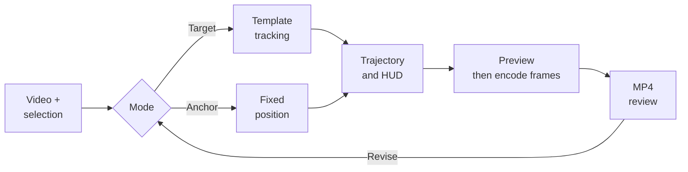

# 07 / Motion Tracking Studio

[Demo](https://trace-01-motion-tracker.limuwen9.chatgpt.site)

**Attach a locator and information overlay to a chosen video target or a fixed position.**

Tech stack: React, TypeScript, Canvas template matching, WebCodecs and mp4-muxer. Tracking estimates visual similarity; it does not recognize semantic object identity.

## Visual overview

[](https://trace-01-motion-tracker.limuwen9.chatgpt.site)

The workspace starts empty: import a video, choose a target or place a fixed anchor. The source is never silently chosen for the visitor. Playback and three white HUD presets sit above the preview; targeting and export controls are alongside it.

### Inspect the actual input and output

| Original test input | Encoded result |
| --- | --- |
| [4-second moving-target clip](evidence/input-moving-target.mp4) | [4K moving-target output](evidence/4k-moving-target.mp4) |
| [Same input with a test tone](evidence/input-target-tone.mp4) | [FHD fixed-anchor output with audio](evidence/fhd-static-anchor-audio.mp4) |

These downloadable MP4s are the exact bounded export fixtures. They contain generated test geometry, not client footage, and demonstrate timing checks rather than production tracking accuracy.

## Workflow and creator control

Import footage and explicitly choose a target or place a fixed anchor. The tracker searches for the selected template and reports confidence/reacquisition state. The creator decides which subject matters, whether to track or pin it, how to label it and when the locator and information panel appear. Smoothing cannot repair a target switch.

Muwen Li defined the target/anchor workflow, staged visual hierarchy and review criteria; Codex assisted implementation.

A motion annotation has two separate requirements: stay attached to the correct subject and remain readable. Tracking may drift, while labels can arrive too early, cover the subject or distract from it. Treating the tracker and graphic styling as separate tasks makes those problems harder to inspect together.

Bring source video, frame navigation, target positioning and HUD design into one workspace. Expose **Track a target** and **Position anchor** as distinct choices. Separate the locator's entrance from the expanded data panel so the viewer first sees the target, then reads its context.

## Try one useful task

1. Import a short, high-contrast video and pause on a clear frame.
2. Choose **Track a target** and select the subject, or choose **Position anchor** for a fixed locator.
3. Play the clip and inspect the path. Adjust **LOCK IN** and **HUD IN** timing separately.
4. Export a short MP4. Source audio is optional and off by default. Check the entire file for subject identity, overlay readability and duration.

Try one difficult interval as well as an easy shot. If the path moves onto the wrong subject, inspect target selection and search behavior instead of using smoothing to hide it. A fixed annotation is a different, explicit creative choice. Frame-level path edits, locked good segments and regional retracking are not established recovery features.

## Workflow diagram



## Local setup

Requirements: Git, **Node.js 22.13+**, **pnpm 11.25.0**, and a desktop browser with Canvas/WebCodecs support. Use Chrome or Edge for comparison with the recorded checks. Install Git and Node.js first, then check `git --version` and `node --version`. Package downloads need internet. No API key or hosted account is needed by this local runner.

Run these commands in PowerShell, macOS Terminal or a Linux shell:

```sh
npm install --global pnpm@11.25.0
git clone https://github.com/MuwenTriLi/creative-workflows.git
cd creative-workflows/projects/07-motion-tracking/source
pnpm install --frozen-lockfile --ignore-scripts
pnpm verify:source
pnpm dev --port 5173 --strictPort
```

Open **http://127.0.0.1:5173/**. Stop the server with Ctrl+C. If 5173 is occupied, stop the other server or choose another port. To check the production bundle:

```sh
pnpm test
pnpm build
pnpm preview --port 4173 --strictPort
```

Open **http://127.0.0.1:4173/** for the built app. Keep the tab in the foreground during export. Try a short FHD output before 4K; a successful build does not establish codec support or available GPU memory on another computer.

The snapshot matches hosted client version **19**. The workspace starts empty: import your own clip or use the small synthetic inputs in [evidence/](evidence/). `pnpm test` checks deterministic frame planning and timestamp limits; it does not measure target accuracy. AAC audio encoding also requires browser support.

The [source manifest](source/source-manifest.json) records the hosted revision and hashes; `verify:source` checks the copied client files. The local Vite runner replaces the hosting wrapper. Public navigation links still open the hosted studios. [Source and media rights](source/RIGHTS.md) apply independently of these setup instructions.

## Features and implementation

### Controls and their purpose

| Creative decision | Visible control | Purpose |
| --- | --- | --- |
| Follow a subject or mark a place? | Track a target / Position anchor | Match the overlay's behavior to the explanation |
| How should the path behave? | Search radius and trajectory smoothing | Balance target search and visual stability |
| When should information appear? | LOCK IN and HUD IN timeline markers | Stage attention before adding detail |
| How much visual emphasis is needed? | Locator size, panel size and entrance mode | Keep the source footage legible |
| What information belongs in the graphic? | Title, text fields, color and HUD presets | Adapt the annotation to the scene |

The tracker exposes confidence and a REACQUIRE state. A live confidence value is not a ground-truth accuracy measure or proof of recovery. A reviewable confidence history, editable correction path and retained revisions remain future work.

### Frame-based output and source responsibilities

| Responsibility | Source |
| --- | --- |
| Target/anchor selection, tracking and Canvas overlays | [page.tsx](source/app/page.tsx) |
| Deterministic frame counts and timestamps | [export-timing.mjs](source/app/export-timing.mjs) |
| Seek the source, encode H.264, mux MP4 and optional AAC | [export-mp4.mjs](source/app/export-mp4.mjs) |

Sequential frame encoding replaces the earlier real-time recording path. It includes cancellation and encoder backpressure; editing is locked during export. Unsupported encoding is reported instead of silently substituting a timing-incorrect output. Source audio is optional and off by default.

## Evidence and next step

A four-second synthetic fixture produced **3840 × 2160, 60 fps, 240 frames, 4.000 seconds**. An FHD run with source audio matched video timing; its AAC container has **10.667 ms** of padding. [Exact inputs, outputs and measured results](docs/export-check.md).

The earlier real-time capture failed the requested timing; the two sequential-encoding fixtures supersede that timing result only. The 30 fps source does not gain new source-motion detail from a 60 fps output container.

Delivery also requires the right subject throughout the sequence, no wrong-target jumps, readable HUD text and no obstruction of essential action. A smooth path can still be attached to the wrong object.

Next: compare an easy authorized clip with one containing an occlusion, annotate ground-truth positions and record wrong-target intervals and correction effort. Target identity through occlusion, real-footage recovery and regional correction remain unverified. Expand only after failure detection and recovery work; otherwise narrow the supported shot or use an explicitly selected fixed annotation. Export timing success is separate from tracking accuracy.
