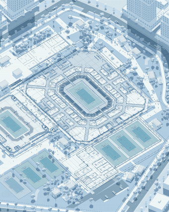
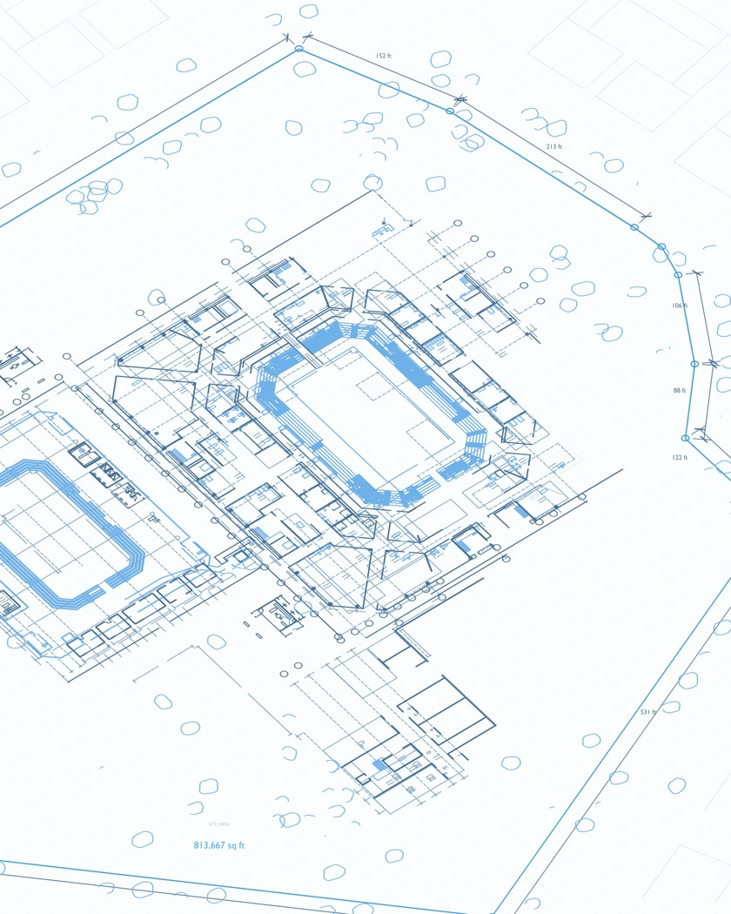
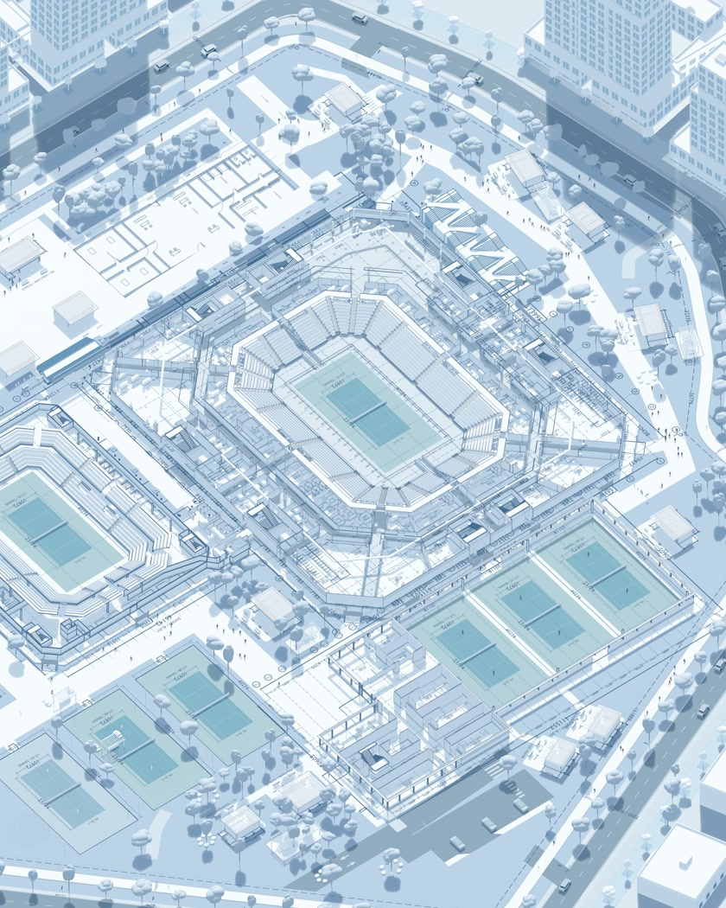
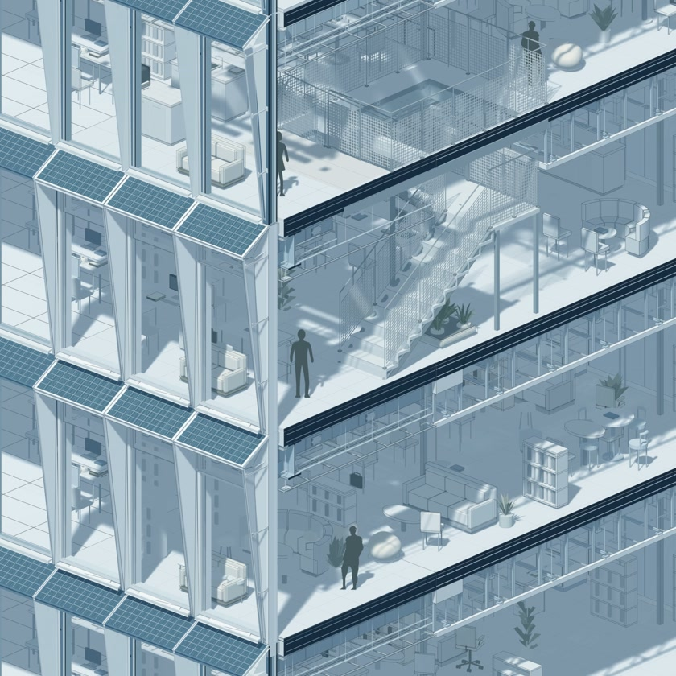
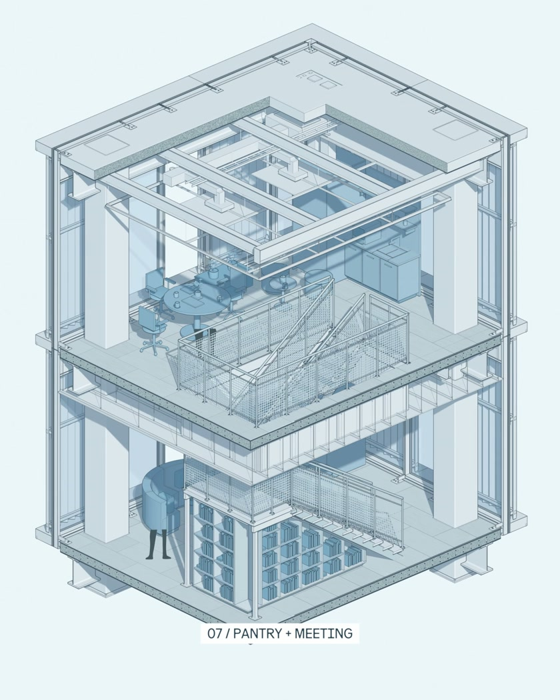
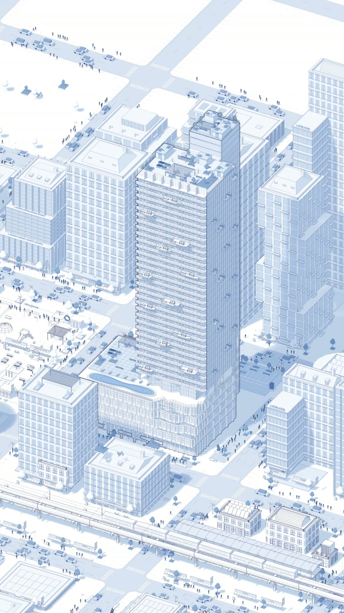
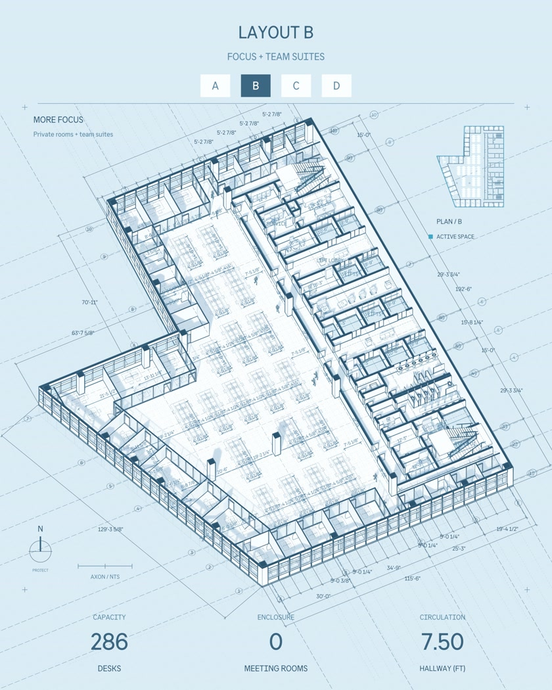

# Blue / White Architecture Growth

**03 / Company production case · illoca · Creative Content Director: Muwen Li**

**Turn a company's visual language into a repeatable architectural storytelling workflow.** A shared internal Skill supports white-model styling, blue-shadow hierarchy and staged construction in Blender; each building still needs its own component logic, framing and review.

[← All projects](../README.md#selected-work) · [Watch the tennis sequence](../media/architecture-growth/tennis-sequence.mp4) · [Selected outputs & credits](../docs/architecture-growth-media.md) · [Production method](#from-company-aesthetics-to-an-internal-skill)

> Portfolio case study. The company-specific visual system and production materials belong to **illoca** and/or their respective rights holders. Selected completed visuals are shown to document Muwen's work; the company Skill, source scenes, code and exact style configuration are not released for reuse.

## Tennis venue: from plan to staged construction

<table><tr>
<td width="50%" align="center" valign="top"> <b>Establish the plan</b> Give the viewer a spatial reference before the model becomes dense.</td>
<td width="50%" align="center" valign="top"> <b>Build a readable sequence</b> Reveal systems in stages while keeping the surrounding context.</td>
</tr></table>

The tennis project is the principal example of the progressively refined method. Both the video and carousel-format sequences use the same visual direction; format, density and timing are adapted to the presentation. The two GIFs are excerpts from supplied completed films. [Watch the complete 33 s carousel-format sequence](../media/architecture-growth/tennis-sequence.mp4).

<table><tr>
<td width="33%" align="center"> Plan / spatial context</td>
<td width="33%" align="center"> Structure / staged growth</td>
<td width="33%" align="center"> Resolution / contextual detail</td>
</tr></table>

## The production problem

A company needs a recognizable visual voice across different buildings and delivery formats. Rebuilding every material, outline and reveal from scratch risks inconsistent styling; applying the same animation blindly risks wrong construction relationships, unreadable details and abrupt transitions.

**Working hypothesis:** separate the reusable visual and review rules from the scene-specific decisions. Let the workflow handle repeated setup, while the director controls the explanation and accepts the final result. Repeated production use supplies examples; it does not by itself quantify time saved or prove that a new user can operate the workflow unaided.

## My role and the company's work

I work as **Creative Content Director at illoca**. For this case, my contribution is defining and refining the visual direction, directing architectural storytelling, developing the reusable workflow with Codex, and reviewing output detail and continuity. The case draws on successive architectural studies, with the tennis venue as a developed application.

The architectural designs, company models, brand expression and completed company media are not presented as independently owned open-source assets. This page describes my contribution to the production method; it does not claim sole authorship of every building or source model. [Presentation scope and credits](../docs/architecture-growth-media.md#rights-and-disclosure).

## From company aesthetics to an internal Skill

The Skill packages a repeatable production procedure. Reuse means adapting a controlled method to a new scene, rather than transplanting the tennis animation unchanged.

| Stage | Repeatable system work | Director's decision / review |
| --- | --- | --- |
| Reference & brief | Inspect the agreed reference and scene constraints | Confirm audience, subject, visual direction and output format |
| Scene interpretation | Inspect component hierarchy and prepare relevant groups | Confirm what each system is and which dependencies matter |
| Visual translation | Apply the established material, shadow and outline language in Blender | Judge silhouette, section detail, scale and visual hierarchy |
| Sequence & emphasis | Prepare staged reveals, transitions and framing previews | Set construction order, focal system, camera and readable pauses |
| Local refinement | Adjust the affected system or passage; prepare another preview | Preserve accepted direction and reject misleading motion or geometry |
| Delivery review | Prepare viewing outputs and technical checks | Inspect continuous motion, detail at final size and the encoded file |

This is a **company-internal workflow/Skill case**, not an installable public Skill. Exact prompts, invocation phrases, parameters, node setups, scripts and scene data are intentionally outside the presentation. The public method explains the production decisions and responsibilities without reproducing the internal implementation.

## A production observation becomes a control requirement

During tennis-scene iteration, a growth stage that returned abruptly from white emphasis to the blue material state read like a visual glitch. That observation leads to a concrete system requirement: **provide a controlled handoff between reveal emphasis and the settled material, and review the transition with its neighboring frames**.

The same reasoning applies to inconsistent dashed-line density and unclear road/landscape boundaries: the system needs distinct hierarchy controls and a check at the final viewing size. The director decides whether the distinction is readable without competing with the architecture. The final films show the refined visual direction; a separately approved before/after recording of this correction is still to add. No numerical improvement is claimed.

## One method, different scales of explanation

<table><tr>
<td width="25%" align="center" valign="top"> <b>Detail A</b> Floor, facade and sectional depth <a href="../media/architecture-growth/detail-a.mp4">25 s film</a></td>
<td width="25%" align="center" valign="top"> <b>Detail B</b> Structure, enclosure and interior layers</td>
<td width="25%" align="center" valign="top"> <b>Tower study</b> Building scale and urban context</td>
<td width="25%" align="center" valign="top"> <b>Office typology</b> Plan reading and spatial alternatives</td>
</tr></table>

[Detail C: complete 35 s building-and-context sequence](../media/architecture-growth/detail-c.mp4) · [Full media notes](../docs/architecture-growth-media.md)

## What makes the work deliverable

The visual specification must remain coherent across shots. Outer silhouettes, structural edges and fine detail need readable hierarchy; section surfaces and architectural scale must remain plausible; furniture and people must support the explanation; transitions must avoid abrupt jumps, intersections and flicker. Inspect risky passages as consecutive frames and check the actual encoded video, not only attractive stills.

For a new scene, the system can repeat confirmed setup and prepare bounded previews. The creator reviews construction dependencies, substitutions, camera changes and final publication. Changing a building's meaning or replacing the company's reference is not a routine automatic choice. Local correction should preserve the accepted scene and unrelated timing; a universal rollback system is not claimed here.

## Evidence and next decision

**Available:** completed tennis, detail, tower and office outputs; the director's stated role; a reusable internal method and an iteration rationale. Presentation MP4/GIF copies were prepared and decoded locally from the supplied media. No new Blender render, source-package audit or independent creator study was performed for this page.

**Next experiment:** document one approved shot from brief through one local correction and final review, without exposing internal source files. Record where the director intervenes and how the accepted choices are preserved. For repeatability, compare a second scene under the same approved visual brief.

**Decision:** continue the bounded internal workflow and make its correction process easier to inspect. Expand only when the new scene preserves the visual standard and construction logic; iterate when grouping or transitions need repeated repair; stop a reusable rule when it damages scale or architectural meaning. Broad automatic transfer to arbitrary models is not established by these films.

[Evidence still to add](../docs/evidence-to-add.md) · [Automation and creator control](../docs/creative-control.md)
